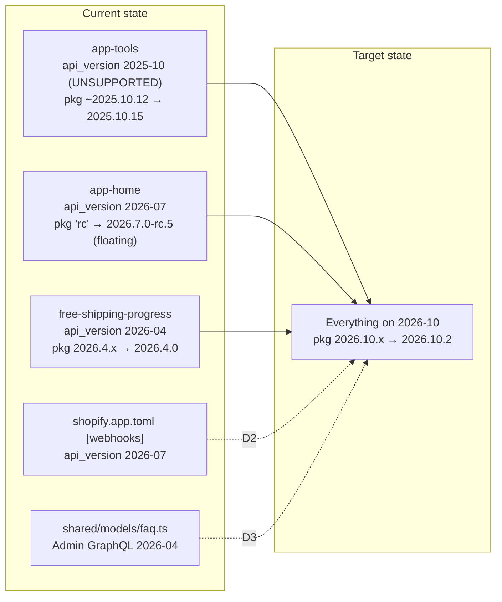

# Implementation Plan: `upgrade-api-version-2026-10`

**Status:** REVISED. Revision 3 responds to review Pass 3 (APPROVE WITH CHANGES). Ready for review Pass 4.

**Slug:** `upgrade-api-version-2026-10`
**Author:** Architect
**Date:** 2026-10-23 (revisions 1–3 on the same day)
**Type:** Chore / platform upgrade. Behaviour is meant to stay the same. No feature brief exists; the operator's request is the source of truth.
**Target API version:** `2026-10` (latest stable, released 2026-10-01)
**Review:** `docs/reviews/upgrade-api-version-2026-10-review.md`

---

## Revision log

> Step names changed in revision 2. Phase B steps B1–B3 are now **BL1–BL3**, and the final steps
> F1–F7 are now **Z1–Z7**. The revision-1 rows below use the new names. `F1`–`F7` always mean **review
> findings**.

**Revision 3 (2026-10-23).** This revision answers review Pass 3. All three REQUIRED items are confined to
the operator runbook (§3.5, §3.6) and the QA identity checks (AC-11 to AC-13, O6). NITs P3-N1 to P3-N5
are taken. Phases A–C and Z1–Z7 are unchanged apart from the NITs: Z4 and C1.6 step 4 gain the O0 gate,
and C1.6 step 4 is marked optional.

| Item | Where it is handled |
| :-- | :-- |
| **P3-1** O4b could clean before the release was active, and O7 had no baseline | §3.6 now runs O4 → **O5 → O4b**. O4b requires O4 to have succeeded **and** O5 to confirm the new version is active. If O2(b) found the old version missing anything that is in the preview, the operator also waits out the propagation window (about 1 hour) and re-confirms before cleaning. New **O2(d)** records the FAQ count and questions before any clean or release, and O7 compares against it. |
| **P3-2** a rollback release can delete data | §3.5 step 2 is rewritten. A rollback release is potentially destructive: releasing a version that lacks `$app:faq` deletes the definition, and its metaobjects follow after a short retention. The operator checks O2(b) first and prefers containment plus fix-forward. A release confirmation that lists deletions is never accepted without an explicit, recorded operator decision. A recovery note covers promptly re-releasing a version that contains `$app:faq`. O8 points to all of this. |
| **P3-3** identity checks didn't fail safe | **AC-11, AC-12 and AC-13:** the dev-tunnel bundle origin is now a **hard gate**. If it can't be determined, identity is unknown, so stop. The Dev Console is corroboration only, and an unreadable Console is recorded as "unknown". AC-13 relies on the AC-11 gate plus the `dev` log, or else records "identity unconfirmed". **O4b:** CLI only, with its success output recorded verbatim. **O6:** requires that output, plus the Dev Console showing no preview if it can be opened without `dev`. "Not from a tunnel" is necessary but not sufficient. If identity can't be shown, record "identity unconfirmed", not a pass. **Nobody starts `dev` after O4b.** R14 is revised to match. |
| P3-N1 | The status line, the date line, R6 ("Step BL1") and AC-3 ("BL3") are fixed. The rename sweep was redone, and the manifest claim corrected (§8, Revision 3 checks). |
| P3-N2 | O4 says **(b), the CLI release confirmation, is the binding deletion check**. (a) is a pre-check. |
| P3-N3 | New **O0** is an operator pre-flight **before `/implement`**, so before the first `dev` run. It records O2's (a)–(d) and stops if the store has anything the repo lacks. Z4 and C1.6 step 4 require O0 to be recorded before running `dev`. |
| P3-N4 | AC-12's test FAQ is named `QA TEST – upgrade-api-version-2026-10 – delete me`, and the FAQ count is re-checked after deletion. |
| P3-N5 | C1.6 step 4's extra `dev` run is marked **optional**. If it's skipped and Z4 regenerates the `.d.ts`, Z4.3 restores HEAD and records the diff. |

**Revision 2 (2026-10-23).** This revision answers review Pass 2: P2-1 to P2-5 are addressed, and NITs
P2-N1 to P2-N6 are taken. The user also answered OQ-6 and OQ-7 during this round, so both are now
**resolved**. Folding in OQ-7 surfaced a dev-preview hazard, recorded in the last row.

| Item | Where it is handled |
| :-- | :-- |
| **P2-1** `TSC(e)` captures pnpm stdout | `TSC(e)` and every `dlx` call now pass `--reporter=silent`. BL2 adds a check that every E0 line is a tsc diagnostic or a continuation line. **Tested by the coordinator and not reproduced on pnpm 11.9.0:** with stdout piped to a file, `pnpm --package=typescript@6 dlx tsc -v` wrote only `Version 6.0.3`, twice, with or without `--reporter=silent`. Both additions are kept as cheap guards. The PM referent is corrected: the current binary is 11.9.0, and 11.5.2 is what last installed `node_modules`. |
| **P2-2** PM_build has no pass condition when nothing is installed | Outcomes are now defined in BL1.4, the PM_build row and AC-4: a pnpm install line is a pass; no install line is "not invoked" and acceptable with G-npm green; an npm, yarn or bun line means stop. The CLI version is recorded next to PM_build. |
| **P2-3** DC-f's yarn claim, and G-npm missing `yarn.lock` | The DC-f line-44 text now states the real precedence: a stray `package-lock.json` goes stale, but a stray `yarn.lock` **takes precedence** and switches the CLI to yarn. The line-186 text covers `yarn.lock` too. G-npm gains `test ! -e yarn.lock` and now has five lines. |
| **P2-4** the O3 change summary | The "3 extensions updated, no deletions, no unexpected config" check moves to O4: first the new version's Dev Dashboard page, then the interactive `shopify app release` confirmation, with no `--allow-*` flags. O3's pass condition is now "version created, name recorded". |
| **P2-5** naming collisions and stale references | Final steps are renamed Z1–Z7, and Phase B steps BL1–BL3, with all references updated (including §4's "(Z5)" and R5's "BL1"). O1 now says "HEAD is C6, or the later QA-report or QA-fix commit". The precedent is that `86e12c7` and `32cac43` committed QA artifacts separately. O1 also now points at O6, not O5. |
| P2-N1 | AC-8(b) and C1.5 gain a fallback. If the export count is 0, check the installed version and search `build/ts` for the export before calling it a failure. If the version is `2026.10.*` and E1(app-tools) is empty, escalate it as "export moved", not as a failed bump. |
| P2-N2 | BL2 says extra diagnostics in E0 under TS 6, such as implicit-any errors, are expected, provided E1 = E0. |
| P2-N3 | The NPM_art row now matches C0.4. |
| P2-N4 | The §3.5 containment step now says to **save** the checkout-editor change. It also notes that only the checkout extension has this switch. |
| P2-N5 | OQ-4 is resolved: `cmp` exits 0 (coordinator shell). The `d15838d` gap is resolved: it touches only `extensions/free-shipping-progress/src/Checkout.jsx`, +1/−1 (coordinator shell). The N_doc row and the manifest are updated to match. |
| P2-N6 | C2.2 and C3.2 now say that C1.6 step 5 applies to app-tools only. |
| **OQ-6 (user)** | **Resolved:** include DC-e. Its status in §3.3 and in C5.1 is updated. |
| **OQ-7 (user)** | **Resolved:** the released version is active on `theme-evolution-os2.myshopify.com`, the same store as the dev store. §3.6 O2, O6 and O7 name it. |
| **Dev store = live store** (found while folding in OQ-7) | shopify.dev says a **dev preview persists after `shopify app dev` stops**, and `shopify app dev clean` "restores the active released version", deleting any extension placement, configuration or metaobjects that version lacks. Revision 1 wrongly assumed that stopping `dev` restored the release. **Fixes:** R13 is rewritten. New R14 covers telling preview from release by identity rather than behaviour. AC-11 adds a Dev Console identity check and says not to clean. Z4 and C1.6 say "stop `dev`, do not clean". §3.6 gains **O4b**, which cleans the preview **only after a successful release**. O2 records the old version's contents, and O6 and O7 run after O4b with identity checks. §3.5 warns against cleaning while an older version is active. |

**Revision 1 (2026-10-23).** This revision answers review Pass 1 and the user's answers to OQ-1, OQ-2 and OQ-3 and to D5. All 7 REQUIRED findings are addressed. NITs N1–N6, N8 and N9 are taken; N7 only changes the rationale of a follow-up.

| Item | Where it is handled |
| :-- | :-- |
| **F1** tsc can compare two empty runs | Step BL2 now pins `typescript@6.x` and passes `--ignoreDeprecations 6.0` on the command line. A positive control requires E0 to contain `Checkout.jsx:223` and `FaqPage.jsx:82`. Any `TS5xxx` diagnostic means stop. AC-8 is rewritten. |
| **F2** the app-tools `shopify.d.ts` baseline | Step A4 saves the working-tree diff and restores HEAD. Step BL1 records sha256 before and after the B0 build. AC-8(b) is replaced by a direct check that the installed package exports `WithGeneratedTools`, and E1(app-tools) must be empty. The E0 row now names HEAD's `.d.ts`. The C1 commit body is worded by outcome. |
| **F3** AC-11 never reads `deliveryGroups` | AC-11 adds `free-shipping-progress` §11 checks 1, 3 and 12. The operator's manual walk-through is an accepted method, recorded per check. (i) gets a visual fallback. Editor settings are restored afterwards. |
| **F4** bundle headroom based on one extension | AC-7 and R9 now apply the headroom wording to free-shipping-progress only. If B0(e) > 64 KB for any extension, stop and escalate (Step BL1). |
| **F5** untracked plan and review | Step A0 commits the plan and review in a docs-arc commit, and `<base>` is that commit. |
| **F6** AC-14 pathspec | AC-14 uses explicit paths, plus a positive control over `d15838d`. |
| **F7** component lists | DC-b now corrects both `CLAUDE.md` component lists against the 2026-10 component set. |
| N1, D5 | `brew upgrade shopify-cli`. Record `shopify version` at the start (A1) and the end (Z1). |
| N2 | Every build runs with `--verbose`, and the package manager it invokes is recorded. Guard G-npm runs after every install and build. Stray npm artifacts are cleared by the C0 clean reinstall. |
| N3 | Moot, because no npm lockfile is generated any more (D6). |
| N4 | AC-4 is now the pnpm-only guard, with exact commands. |
| N5 | The line-136 row now says exactly what to insert. |
| N6 | The line-183 policy is split out of DC-a into DC-e. |
| N8 | Noted in AC-7. |
| N9 | AC-1 now requires *every* `shopify:admin/api/` URL to say `2026-10`. |
| N7 | Follow-up rationale updated. |
| **OQ-1 (user)** | `package-lock.json` is deleted and pnpm becomes the only package manager. D6 is rewritten. A new commit C0 does this, and DC-f updates the docs. D8 decides the root `workspaces` field. |
| **OQ-2 (user)** | A version with the checkout extension is live. A new §3.6 covers the operator deploy and release. §3.5 rollback is rewritten. A follow-up records that the deploy procedure needs documenting. |
| **OQ-3 (user)** | DC-b, DC-c and DC-d are accepted. Both doc files are updated and stay byte-identical. DC-f (package-manager guidance) is required. |

---

## MCP grounding note (must read)

The Shopify Dev MCP **was registered** in the Architect's environment and was used throughout this plan.
`learn_shopify_api` was called for `polaris-checkout-extensions`, `polaris-admin-extensions` and `admin`,
each with **`version: "2026-10"` passed explicitly**. The operator's brief reports that the MCP's default
version lags (it defaults to 2026-07), so the Coder and Plan-Reviewer must also pass `version: "2026-10"`
explicitly.

What the MCP confirmed at 2026-10 (each item is tagged in the referent table below):

- **Checkout target** `purchase.checkout.block.render` is present in the 2026-10 target list.
- **Signals used by `free-shipping-progress`** are present and unchanged in shape at 2026-10:
  - `shopify.lines` is `SubscribableSignalLike<CartLine[]>` (Cart Lines API, 2026-10).
  - `shopify.cost.totalAmount` is covered by the Cost API at 2026-10.
  - `shopify.deliveryGroups[].deliveryOptions[]` still carries `cost` ("before any shipping discounts")
    and `costAfterDiscounts` ("the price the buyer actually pays").
  - `shopify.settings` is `SubscribableSignalLike<ExtensionSettings>`.
  - `shopify.i18n.formatCurrency(number | bigint, {inExtensionLocale?} & NumberFormatOptions) => string`.
  - `shopify.i18n.translate`. Per the 2026-10 docs, "If the replacements are all primitives, then
    `translate()` returns a single string".
- **Components** at 2026-10:
  - `s-progress` still has `tone: 'auto' | 'critical'`, `value`, `max` and `accessibilityLabel`.
  - `s-stack` and `s-text` are present.
- **Validator check.** I ran the whole of `extensions/free-shipping-progress/src/Checkout.jsx` through
  `validate` (`polaris-checkout-extensions`, target `purchase.checkout.block.render`, version `2026-10`).
  It reported exactly **one** error: the already-known `accessibilityLabel` `string | any[]` type error
  (see D4). It found no other component, prop or API errors.
- **Admin targets:**
  - `admin.app.tools.data` is documented at 2026-10 (`/docs/api/admin-extensions/2026-10/targets/app-tools`).
  - `admin.app.home.render` "requires API version `2026-07` or later", so 2026-10 qualifies.
- **Admin GraphQL.** All five operations in `shared/models/faq.ts` validate against the **2026-10**
  Admin schema:
  - `metaobject`
  - `metaobjects(type:, first:, sortKey:, reverse:)`
  - `metaobjectCreate`
  - `metaobjectUpdate`
  - `metaobjectDelete`

**Correction to the operator's brief.** `free-shipping-progress` does **not** read `shopify.extension.target`.
A grep of `extensions/free-shipping-progress/src/` finds no `shopify.extension`. That accessor is used by
`extensions/app-home/src/pages/HomePage.jsx` (the `welcome` heading). The upgrade doesn't depend on this
either way.

**New facts found during grounding that the brief did not include:**

1. **A fifth version pin.** `shared/models/faq.ts` hardcodes
   `fetch("shopify:admin/api/2026-04/graphql.json", …)`. This module is shared by `app-home` and
   `app-tools`, and it is an Admin GraphQL version that is separate from any extension `api_version`.
   See D3.
2. **Deployability deadline (quoted).** Shopify changelog, 2026-09-17: *"To remain deployable after
   October 1, 2026, an app must ensure that every existing UI extension uses API version 2026-01 or later."*
   `app-tools` is on `2025-10`, so **the app as a whole cannot be deployed today**, not just that one
   extension.
3. **Bundle limit (quoted).** The same changelog says *"UI extensions using API version 2025-10 or later
   are limited to a 64 KB compressed JavaScript bundle per extension."* `CLAUDE.md` still says "~100KB" in
   three places. See DC-c.
4. **Admin GraphQL breaking change in 2026-10.** Invalid metafield **filter** predicates now return
   errors. `faq.ts` filters metaobjects by `type` and sorts by `updated_at`. It does not filter by
   metafield, so it is **not affected**.
5. **`owner_type` for metafield declarations** (2026-10 optional, 2027-01 required). This only applies to
   `[[extensions.metafields]]` and `[[extensions.targeting.metafields]]` in Checkout and Customer Account
   extension TOMLs. No extension TOML here has either block (all three were read). The
   `[product.metafields.app.faq]` definition in `shopify.app.toml` is an app-level declaration, not an
   extension metafield declaration, so it is **not in scope**. This is a forward-looking note for the
   2027-01 upgrade only.

---

## Referent table (every figure in this plan cites a row)

Tags: `[measured]` = re-read or re-run by the Architect on 2026-10-23. `[quoted]` = taken from a named
source and not re-measured. `[user-verified]` = established by the user and reported in the revision
request. `[to measure]` = the Coder records it in Phase A or B (§7). `[provisional]` = nothing is built on
it.

| Sym | What it measures | Units | Artifact | Extent / band | Threshold or method | Current value |
| :-- | :-- | :-- | :-- | :-- | :-- | :-- |
| **V_ext(e)** | `api_version` declared for extension *e* | version string | `extensions/<e>/shopify.extension.toml` | the top-level `api_version =` line only | must equal `2026-10` | app-tools `2025-10` (line 1); app-home `2026-07` (line 1); free-shipping-progress `2026-04` (line 6) `[measured]` |
| **V_wh** | Webhook payload API version | version string | `shopify.app.toml` | the `[webhooks]` table's `api_version` key only (line 12) | `2026-10` if D2 is accepted | `2026-07` `[measured]`. No `[[webhooks.subscriptions]]` declared `[measured]` |
| **V_adm** | Admin GraphQL version used by direct API access | version string | `shared/models/faq.ts`, `gqlFetch` | the URL path segment between `api/` and `/graphql.json` (line 29) | `2026-10` if D3 is accepted | `2026-04` `[measured]` |
| **S_pkg(e)** | `@shopify/ui-extensions` dependency specifier | semver range or dist-tag | `extensions/<e>/package.json` → `dependencies` | that one key | must equal `"2026.10.x"` | app-tools `~2025.10.12` (line 7); app-home `rc` (line 10, a floating dist-tag); free-shipping-progress `2026.4.x` (line 9) `[measured]` |
| **R_pkg(e)** | Resolved `@shopify/ui-extensions` version for importer *e* | exact version | `pnpm-lock.yaml` → `importers:` → `extensions/<e>` | the importer's `version:` field, **not** the `packages:` section | all three must be equal and `2026.10.*` | app-tools `2025.10.15`; app-home `2026.7.0-rc.5`; free-shipping-progress `2026.4.0` `[measured]`. Expected after upgrade: `2026.10.2` (npm dist-tag `2026-10`) `[quoted: brief, 2026-10-23]` |
| **R_peer** | Resolved versions of the other runtime deps | exact versions | `pnpm-lock.yaml` → `importers:` | `preact`, `@preact/signals`, `preact-iso` | unchanged, unless pnpm reports a peer requirement (record it if so) | `preact 10.29.2`, `@preact/signals 2.9.1`, `preact-iso 2.12.0` `[measured]` |
| **I_pkg(e)** | Installed `@shopify/ui-extensions` version for importer *e* | exact version | output of `pnpm ls -r --depth 0 @shopify/ui-extensions` | per importer | must equal R_pkg(e) | `[to measure]` |
| **NPM_lock** | State of the root npm lockfile | n/a | `package-lock.json` | `packages."extensions/*"` entries | **Deleted in C0** (D6, user decision on OQ-1) | **Stale.** It has no `extensions/free-shipping-progress` entry at all. app-home is `"rc"`, hoisted to `2026.7.0-rc.5`. app-tools is `~2025.10.12` → `2025.10.15` `[measured]`. **The CLI never reads it** while `pnpm-lock.yaml` or `pnpm-workspace.yaml` exists `[user-verified: shopify-cli 4.8.5, dist/chunk-5GUXN2RU.js, getPackageManager]` |
| **NPM_art** | Leftovers from an earlier npm install | file presence | `node_modules/.package-lock.json`; `node_modules/@shopify/ui-extensions` at the root (`2026.7.0-rc.5`); `extensions/app-tools/node_modules/.ignored/` | n/a | `node_modules/.package-lock.json` and `extensions/app-tools/node_modules/.ignored/` **must be absent** after the C0 clean reinstall (the first is also part of G-npm). The root `node_modules/@shopify/ui-extensions` is **record-only**: if it reappears after a clean **pnpm** install, it is pnpm hoisting, not npm, and not a failure (C0.4) | present `[quoted: review N2; the first and second were also observed by the Architect]` |
| **PM** | pnpm version: the binary in use, and the version that last installed `node_modules` | name@version | `pnpm -v` (binary); `node_modules/.modules.yaml` → `packageManager` (last install) | n/a | the Coder uses pnpm major 11. A2 records `pnpm -v` | binary `11.9.0` `[coordinator shell, 2026-10-23]`. Last install by `pnpm@11.5.2` `[measured]`. Both are major 11 |
| **PM_build** | Package manager that `shopify app build` uses for its own dependency install | name, plus the CLI version it was observed on | `shopify app build --verbose` log | the dependency-install line(s) | **pass:** an install line naming pnpm. **Acceptable:** no install line at all, which is recorded as "not invoked" and requires G-npm to be green. **Stop:** an install line naming npm, yarn or bun | Expected pnpm, because `getPackageManager` checks `yarn.lock`, then `pnpm-lock.yaml` or `pnpm-workspace.yaml`, then bun, and `package-lock.json` last `[user-verified on CLI 4.8.5]`. The run uses the upgraded CLI, so PM_build is the only observation of the CLI that actually runs `[to measure]` |
| **CLI** | Shopify CLI version | semver | `shopify version` | the value at the start of the run (A1, after the upgrade) and at the end (Z1) | ≥ 4.9.4 (D5) | installed `4.8.5` through Homebrew (`/opt/homebrew/Cellar/shopify-cli/4.8.5`) `[user-verified]`; latest `4.9.4` `[quoted: brief]`. The CLI can upgrade itself mid-run (review N1) |
| **DTS_sha** | sha256 of `extensions/app-tools/shopify.d.ts` | hex digest | output of `shasum -a 256` | the file in the working tree | used to *observe* whether a CLI command rewrote the file | `[to measure]`: at HEAD after A4, before and after the B0 build, and before and after each later build or dev run |
| **B_prev** | free-shipping-progress compressed bundle at the last QA | KB compressed | `docs/qa/free-shipping-progress-report.md`, section "Build check (Step 3)" | the "~X KB compressed" figure, **not** "original" | context only, **not** the baseline for the delta | 8.7 KB (22.2 KB original) `[quoted]` |
| **B0(e)** | Compressed bundle per extension **before** package changes | KB compressed | `shopify app build --verbose` output at step BL1, after the CLI upgrade and the C0 clean reinstall, before any version change | that extension's "~X KB compressed" figure | baseline for the delta. **If B0(e) > L, stop and escalate:** that is a pre-existing deploy blocker, not an upgrade regression | `[to measure]`. app-home and app-tools have **no** prior recorded size |
| **B1(e)** | Same figure **after** the upgrade | KB compressed | `shopify app build --verbose` output at step Z2, after the last code commit | same | gate: ≤ L. Flag (not a failure) if (B1 − B0) / B0 > 10%. Mark the delta "not comparable" if CLI_start ≠ CLI_end | `[to measure]` |
| **L** | Platform bundle limit | KB, compressed JavaScript, per extension | Shopify changelog 2026-09-17, "Request a bundle size exception for existing UI extensions" | per UI extension. The 128 KB variant applies only to full-page customer account extensions, which this app has none of | 64 KB | `[quoted]` |
| **E0(e) / E1(e)** | TypeScript diagnostics for extension *e* | set of `file(line,col): error TSnnnn` lines, sorted | `TSC(e)` (§7 conventions): `pnpm --reporter=silent --package=typescript@<TSV> dlx tsc -p extensions/<e>/tsconfig.json --noEmit --pretty false --ignoreDeprecations 6.0`. `--reporter=silent` keeps pnpm's own output out of the capture (P2-1). **TSV** is one exact `6.x.y`, recorded and used for every run. For app-tools, E0 is measured with **HEAD's** `shopify.d.ts` (restored at A4), **not** the uncommitted working-tree copy | the whole program that tsconfig produces, which includes `shared/` through imports for app-home and app-tools | compare **sets**, not counts. **Positive control:** E0(free-shipping-progress) contains a `Checkout.jsx(223,` diagnostic, E0(app-home) contains a `FaqPage.jsx(82,` diagnostic, and no E0 or E1 line matches `error TS5[0-9]{3}`. Every captured line is a tsc diagnostic or a continuation line (BL2). Otherwise stop (AC-8). Extra diagnostics under TS 6, such as implicit-any errors, are expected, provided E1 = E0 (P2-N2) | `[to measure]`. The brief's figures are **superseded**: they were taken with an unrecorded TS version, and the app-tools figure used the uncommitted `.d.ts` (review F1, F2), so nothing here builds on them. The free-shipping-progress semantic error was independently reproduced by the MCP validator at 2026-10 `[measured]` |
| **N_doc** | Stale version, budget, package-manager and component strings in project docs | occurrence count | `CLAUDE.md` (and `AGENTS.md`) | whole file | 0 after DC edits (AC-10) | `2026-04` × 11 at lines 5, 7, 13, 110, 116, 136, 176, 183, 208, 244, 341. `100KB` × 3 at lines 76, 111, 355. Mixed-package-manager text at line 44. `package-lock.json` in "What NOT to change" at line 186. Non-existent components at lines 126, 128, 129, 261, 263, 265, 266, 267, 268 `[measured, rg; line numbers re-read in revision 1]`. **Byte identity is verified:** `cmp CLAUDE.md AGENTS.md` exits 0 `[coordinator shell, 2026-10-23]` (OQ-4 resolved). A3 re-runs `cmp` as a cheap guard |

---

## 1. Problem statement and goals

The Shopify apps dashboard warns that this app's API version is outdated. The app currently carries five
different version pins across three version generations:



**Why it matters:**

- **Deploy blocker.** Because `app-tools` is on `2025-10`, which is earlier than the `2026-01` floor, the
  **whole app** cannot be deployed after 2026-10-01 (changelog, quoted above). `2025-10` is also listed as
  "Unsupported" (brief: its access window ended 2026-10-16).
- **Reproducibility hazard.** `app-home` depends on the floating `rc` dist-tag. A fresh install resolves
  to whatever the current RC is: a 2026.10 RC today, a 2027-01 RC later. The lockfile pins
  `2026.7.0-rc.5`, which is a *pre-release* of the API version the extension declares.
- **Drift.** Three extensions on three different versions means three different API surfaces to reason
  about, and the project docs only describe one of them (`2026-04`).
- **It is live.** An app version that includes the checkout extension is currently deployed and active on
  `theme-evolution-os2.myshopify.com`, **which is also the dev store** `[user-verified, OQ-2 and OQ-7]`.
  See R13 and R14 for what that overlap means. The dashboard warning reflects that released version. It clears only
  after a new version is **deployed and released** (§3.6).
- **Lockfile ambiguity.** Two lockfiles are committed, but only one is ever read. The CLI picks pnpm and
  never reads `package-lock.json` (NPM_lock row), which is why that file went stale.

**Goals:**

1. Every extension's `api_version` is `2026-10`.
2. Every extension's `@shopify/ui-extensions` specifier is the stable range `2026.10.x`, with no floating
   dist-tags, resolved and installed consistently.
3. The app-level version pins (webhooks under D2, the Admin GraphQL URL under D3) are also `2026-10`.
4. **Observable behaviour is unchanged:**
   - Checkout progress bar states.
   - App Home FAQ CRUD.
   - Sidekick tool registration.
5. `CLAUDE.md` and `AGENTS.md` describe `2026-10` correctly and stay byte-identical. They also state
   correctly that pnpm is the only package manager.
6. **pnpm is the only package manager.** `package-lock.json` is deleted, there is a single
   `pnpm-lock.yaml` at the root, and no npm lockfile or npm artifact comes back after any install, build
   or dev run (AC-4).
7. **After QA approval, the operator deploys and releases the new version** (§3.6). That is what clears the
   dashboard warning.

## 2. Non-goals

- **A Coder or `/ship` deploy.** `/ship` is not operational: `CLAUDE.md` § Deploy targets says no deploy
  target is configured, and the project DevOps agent refuses by design. Deploying and releasing is a
  **manual operator step** after `docs/qa/upgrade-api-version-2026-10.approved` exists (§3.6). The
  Coder never runs `shopify app deploy` or `shopify app release`.
- **Documenting a permanent deploy procedure** in `CLAUDE.md` and `.claude/agents/devops.md`. It is
  needed now that the app is live, but it is a follow-up (§6). §3.6 is a one-off runbook for this
  release only.
- **Fixing the two pre-existing type errors** (D4). They are recorded for follow-up `fix-` slugs.
- **Any source-code change** beyond the one-line Admin GraphQL version literal in `shared/models/faq.ts`
  (D3). No refactors, no adoption of new 2026-10 APIs, and no changes to locale strings, so i18n is
  unaffected.
- **Adding `owner_type`** to metafield declarations. None exist in extension TOMLs (see grounding note,
  item 5).
- **Removing the hardcoded Admin GraphQL version** from `faq.ts`, for example by relying on an
  unversioned `shopify:admin/api/graphql.json`. Review N7 found documentary support for it, but it is a
  runtime-behaviour change, so it is a follow-up only.
- **Stale `CLAUDE.md` content outside the DC edits.** That covers:
  - the `--force` deploy flag (removed in CLI 4.0)
  - "no admin UI"
  - the claim that `shopify app build` validates TypeScript
  - the kebab-case attribute examples at line 271
  
  The component inventories and the package-manager text **are now in scope** (DC-b, DC-f). See §6
  Follow-ups.
- **Removing the root `package.json` `workspaces` field** (D8).
- **Editing the user's auto-memory file.** It is outside the repo (see §6 Follow-ups).
- **Bumping to `2027-01`.** It is a release candidate (RC), not stable.

## 3. Proposed design

### 3.1 Decisions

**Decision log (revision 1):**

| ID | Status |
| :-- | :-- |
| D1 | Open default, not challenged by the review |
| D2 | Open default, not challenged by the review |
| D3 | Open default, not challenged by the review |
| D4 | Open default, not challenged by the review |
| D7 | Open default, not challenged by the review, amended for A0 and C0 |
| D5 | **Resolved by the user:** Homebrew upgrade |
| D6 | **Resolved by the user:** delete `package-lock.json`, pnpm only |
| D8 | **New:** keep `workspaces` |

The operator may still override any open default (OQ-5).

| ID | Decision | Recommendation | Why |
| :-- | :-- | :-- | :-- |
| **D1** | Specifier form for `@shopify/ui-extensions` | **`"2026.10.x"`** in all three `package.json` files | It matches the CLI-scaffolded style already used by free-shipping-progress (`2026.4.x`). It allows patch fixes inside the API version and can never cross into another API version: semver `2026.10.x` is `>=2026.10.0 <2026.11.0-0` and excludes pre-releases. I rejected the alternatives: `~2026.10.2` is equivalent but inconsistent in style; an exact `2026.10.2` misses patch fixes; any dist-tag (`rc`, `latest`, `2026-10`) floats. |
| **D2** | Bump `[webhooks] api_version` from 2026-07 to 2026-10 | **Yes** | **Zero runtime effect today:** no subscriptions are declared, and the only 2026-10 webhook breaking change, tax-webhook GIDs, only matters if subscribed (brief). **Benefit:** one version app-wide, the doc rule in DC-e becomes simple ("everything on the same version"), and it removes a future dashboard trigger (2026-07 leaves support about 12 months after release). **Cost:** one line in a CLI-managed file. `CLAUDE.md` allows this "when explicitly required by a plan", and this plan requires it. **Tradeoff if declined:** the doc rule must carve out webhooks, and the AC-1 count becomes 3. |
| **D3** | Bump the Admin GraphQL URL in `shared/models/faq.ts` from 2026-04 to 2026-10 | **Yes** | All five operations validate at 2026-10 `[measured]`. The only 2026-10 Admin breaking change found (metafield filter errors) doesn't apply because no metafield filter is used. **Benefit:** the code running inside `app-home` and `app-tools` uses the same API generation as those extensions. **Cost:** one-line source change, exercised at runtime by AC-12. **Tradeoff if declined:** 2026-04 stays supported until about 2027-04, so nothing breaks now, but a sixth version generation stays in the app. |
| **D4** | The two pre-existing type errors | **Out of scope.** Leave both untouched. Record both as follow-up `fix-` items | Neither is expected to change with the upgrade. The brief reported identical tsc results across package versions (those figures are superseded under F1 and F2, and AC-8 re-measures them). The MCP validator reproduces only the known error at 2026-10. Neither affects runtime. The free-shipping-progress one is type-only, because `translate()` returns a string when replacements are primitives (2026-10 docs, quoted above), and the extension passed QA with this code in place. Fixing them changes application code in a plan whose contract is "no behaviour change", and would need its own QA. **Tradeoff:** the tsc baseline stays non-empty, so AC-8 compares *sets* rather than requiring zero. **Consequence:** AC-8 and AC-14 turn red if the Coder fixes them. That is intentional, and both criteria must be revised if the operator overrides D4. |
| **D5** (resolved) | Upgrade Shopify CLI from 4.8.5 to 4.9.4 before starting | **Yes**, with `brew upgrade shopify-cli`. The CLI is a Homebrew install (`/opt/homebrew/Cellar/shopify-cli/4.8.5`) `[user-verified]`, so `shopify upgrade` is not the command. | CLI 4.x follows SemVer since 4.0, so a minor upgrade is non-breaking by contract (changelog 2026-05-21, quoted). A newer CLI is more likely to know about 2026-10 and to generate current `shopify.d.ts`. I did **not** verify whether 4.8.5 accepts 2026-10. AC-6 stays as a guard. The upgrade happens at A1, before any baseline. Record `shopify version` at A1 **and** at Z1 (review N1). CLI 4.x can upgrade itself, so the B0 → B1 delta is marked "not comparable" if the two differ. The L gate is absolute and unaffected. This is a global install that the Liquid theme project shares, but CLI auto-upgrade would change it anyway. |
| **D6** (resolved) | Root `package-lock.json` | **Delete it. pnpm becomes the only package manager.** This is its own commit **C0**, made immediately after the docs-arc commit and before any baseline. C0 also does a clean pnpm reinstall and applies the package-manager doc edits (DC-f). | **User decision (OQ-1).** The installed CLI's `getPackageManager` checks `yarn.lock`, then `pnpm-lock.yaml` or `pnpm-workspace.yaml` → pnpm, then bun, and `package-lock.json` only last. With `pnpm-workspace.yaml` present, the CLI never reads the npm lock `[user-verified]`. That is why it went stale (NPM_lock). **Why a separate, first commit and not folded into C1:** (a) the deletion is independent of every version change, so it cannot change build output, because the CLI never read the file; (b) doing it first means every baseline (B0, E0) and every later build runs on the final package-manager setup, and C1–C3 lockfile diffs contain pnpm changes only (review N3 becomes moot); (c) it can be reverted on its own; (d) a C1 that mixed "delete a lockfile" with "upgrade app-tools" would make the deploy-blocker commit harder to review. **The clean reinstall** (`rm -rf node_modules extensions/*/node_modules` then `pnpm install --frozen-lockfile`) removes NPM_art, so later tsc and build runs read a pure pnpm tree. `--frozen-lockfile` proves the lockfile is self-consistent and changes no versions. **Guard G-npm** (AC-4) runs after every install, build and dev run. It catches the lockfile coming back, including a `shopify app build` dependency install that wrongly used npm (PM_build). |
| **D7** | Sequencing | **A0** docs-arc commit (plan and review) → Phase A pre-flight → **C0** pnpm-only → Phase B baselines → **C1** app-tools → **C2** app-home → **C3** free-shipping-progress → **C4** app-level (D2 + D3) → **C5** docs → final checks (Z1–Z4) → **C6** impl notes (Z5) → `/qa` → operator approval → **operator** deploy and release (§3.6). Each of C1–C4 must pass build, tsc and G-npm. Run `shopify app dev` and QA once at the end. | **app-tools first:** it alone causes the deploy block. **app-home next:** it removes the floating `rc`. **free-shipping-progress last among the extensions:** it is the customer-facing one and the most QA-heavy, so it goes in on a known-good base. Separate commits make `git bisect` and single-surface reverts possible. A single atomic commit is simpler to revert but hides which surface caused a regression. **A0 comes first** so that `<base>` (the A0 SHA) excludes the plan and review files from AC-9 and AC-14 (review F5). The precedent is `7ed0952`, the bug-fix arc commit. |
| **D8** (new) | Root `package.json` `"workspaces": ["extensions/*"]` | **Keep it unchanged** in this plan. Its removal is a follow-up. | **Tradeoff.** The field is read by npm, yarn and bun, not pnpm (pnpm uses `pnpm-workspace.yaml`). **For removing it:** with pnpm as the only manager it is dead metadata, and it invites `npm install` to "work" and recreate `package-lock.json`. **For keeping it:** I have not verified whether any Shopify CLI code path (workspace detection or dependency install) reads `package.json` `workspaces` as well as `pnpm-workspace.yaml`. Removing it is therefore an unverified behaviour change to a file the CLI reads, in a plan whose contract is "no behaviour change". Its presence is harmless to pnpm. **Mitigation for keeping it:** G-npm and the DC-f doc text ("do not run npm or yarn here") catch the failure it invites. The same reasoning applies to the bun-only `trustedDependencies` field. |

### 3.2 What changes, per surface

| # | Surface | File | Change |
| :-- | :-- | :-- | :-- |
| 1 | app-tools | `extensions/app-tools/shopify.extension.toml` line 1 | `api_version = "2025-10"` → `api_version = "2026-10"` |
| 1 | app-tools | `extensions/app-tools/package.json` line 7 | `"@shopify/ui-extensions": "~2025.10.12"` → `"@shopify/ui-extensions": "2026.10.x"` |
| 1 | app-tools | `extensions/app-tools/shopify.d.ts` | **CLI regeneration only, never hand-edited.** The working tree has an uncommitted change of unverified origin. It references `WithGeneratedTools`, which 2025.10.15 does not export and 2026.7.0-rc.5 does `[quoted: review F2, from node_modules]`. **A4 saves that diff and restores HEAD.** C1 commits whatever the CLI produces against the 2026.10 package, if it produces anything (DTS_sha shows it). |
| 0 | pnpm-only (D6) | `package-lock.json` | **Deleted** (`git rm`) in C0. |
| 0 | pnpm-only (DC-f) | `CLAUDE.md`, then copied to `AGENTS.md` | The package-manager text (line 44) and the "What NOT to change" lockfile entry (line 186), in C0 (§3.3 DC-f) |
| 2 | app-home | `extensions/app-home/shopify.extension.toml` line 1 | `api_version = "2026-07"` → `api_version = "2026-10"` |
| 2 | app-home | `extensions/app-home/package.json` line 10 | `"@shopify/ui-extensions": "rc"` → `"@shopify/ui-extensions": "2026.10.x"` |
| 2 | app-home | `extensions/app-home/shopify.d.ts` | CLI regeneration only. No diff is expected, because its imports are version-agnostic target paths. |
| 3 | free-shipping-progress | `extensions/free-shipping-progress/shopify.extension.toml` line 6 | `api_version = "2026-04"` → `api_version = "2026-10"`. **Leave the comment block, targeting, capabilities and settings untouched.** |
| 3 | free-shipping-progress | `extensions/free-shipping-progress/package.json` line 9 | `"@shopify/ui-extensions": "2026.4.x"` → `"@shopify/ui-extensions": "2026.10.x"` |
| 3 | free-shipping-progress | `extensions/free-shipping-progress/shopify.d.ts` | CLI regeneration only. No diff is expected. |
| 4 | app-level (D2) | `shopify.app.toml` line 12 | `api_version = "2026-07"` → `api_version = "2026-10"` (the `[webhooks]` table only) |
| 4 | app-level (D3) | `shared/models/faq.ts` line 29 | `"shopify:admin/api/2026-04/graphql.json"` → `"shopify:admin/api/2026-10/graphql.json"` |
| 1–3 | lockfile | `pnpm-lock.yaml` | **Regenerated by `pnpm install` only, never hand-edited.** Changes go into the commit of the surface that caused them. C0 must leave it byte-unchanged (`--frozen-lockfile`). |
| 5 | docs | `CLAUDE.md`, then copied byte-for-byte to `AGENTS.md` | §3.3 DC-a to DC-e |

Extension targets, settings schemas, capabilities, locales and every `src/` file other than
`shared/models/faq.ts` line 29 are **unchanged**.

### 3.3 Documentation changes (`CLAUDE.md`, then `cp CLAUDE.md AGENTS.md`)

Line numbers were re-read on 2026-10-23, and again in revision 1. **Anchor on the quoted text, not the
line number.**

All replacement text below is written to contain **none** of the strings that AC-1 and AC-10 search for:

- `2025-10`, `2026-04`, `2026-07`, `100KB`
- the stale package-manager phrases
- the removed component names

If it did, those criteria would go red on a correct build.

**Status of each change group (user decision on OQ-3, 2026-10-23):**

| Group | Status | Where it lands |
| :-- | :-- | :-- |
| DC-a | Required | C5 |
| DC-b | Accepted | C5 |
| DC-c | Accepted | C5 |
| DC-d | Accepted | C5 |
| DC-e | Accepted by the user (OQ-6, revision 2) | C5 |
| DC-f | Required by the user | **C0** |

Both files are updated together and stay byte-identical.

**DC-a. Version relabel. This is the core of the request and is required.**

| Line | Anchor (current text) | Replace with |
| :-- | :-- | :-- |
| 5 | `grounds the agent's knowledge in the actual \`api_version = "2026-04"\` API` | `grounds the agent's knowledge in the actual \`api_version = "2026-10"\` API`. Also insert this sentence immediately after "(or the equivalent name the MCP exposes).": `Pass the version explicitly (\`version: "2026-10"\`) to \`learn_shopify_api\` and \`search_docs_chunks\`: the MCP's default version can lag behind the latest stable release.` |
| 7 | `Checkout UI Extensions on \`api_version = "2026-04"\` use` | `…\`api_version = "2026-10"\`…` |
| 13 | `- **Framework:** Shopify Checkout UI Extensions, \`api_version = "2026-04"\`.` | `…\`api_version = "2026-10"\`.` |
| 110 | `for the actual \`api_version = "2026-04"\` surface` | `…\`api_version = "2026-10"\`…` |
| 116 | `available at \`api_version = "2026-04"\`. Use the Shopify Dev MCP` | `…\`api_version = "2026-10"\`…` |
| 136 | `the correct name at \`api_version = "2026-04"\` is \`lines\`` | `…\`api_version = "2026-10"\`…`. **This is a version swap only; insert no other text.** (For the reviewer: `lines` was re-confirmed in the 2026-10 Cart Lines API docs.) |
| 176 | `target availability at \`api_version = "2026-04"\`.` | `…\`api_version = "2026-10"\`.` |
| 183 | `NEVER change \`api_version\` as a drive-by; the entire codebase is tuned for \`2026-04\`.` | `NEVER change \`api_version\` as a drive-by; the entire codebase is tuned for \`2026-10\`.` This is the relabel only. The added policy sentences are DC-e (review N6). |
| 208 | `on \`api_version = "2026-04"\`. Read carefully` | `…\`api_version = "2026-10"\`…` |
| 244 | `Common targets at \`api_version = "2026-04"\`:` | `Common targets at \`api_version = "2026-10"\`:` plus DC-b |
| 341 | `Available field types (verify … at \`api_version = "2026-04"\`):` | Replaced as part of DC-b |

**DC-b. Factual corrections that relabelling makes necessary. Accepted by the user (OQ-3).**
Relabelling a list "at 2026-10" would certify the entries in it, and four lists contain entries the MCP
shows do not exist at 2026-10:

- the targets list
- the field types
- **both component lists** (review F7)

- **Targets list.** Change line 248, `` - `purchase.checkout.contact.render-before` / `render-after` ``, to
  `` - `purchase.checkout.contact.render-after` ``. The 2026-10 target list has `contact.render-after`
  only.
- **Targets list.** Change line 249, `` - `purchase.checkout.payment.render-before` / `render-after` ``, to
  `` - `purchase.checkout.payment-method-list.render-before` / `render-after` ``. The 2026-10 name is
  `payment-method-list`.
- **Field-types block.** Replace lines 341–351 inclusive, from "Available field types" through the
  paragraph that starts "If a field accepts arbitrary hex colors", with:

  ```markdown
  Supported field types at `api_version = "2026-10"` (exhaustive per the Shopify Dev MCP; re-verify on the next upgrade):

  - `boolean`
  - `single_line_text_field`, `multi_line_text_field`
  - `number_integer`, `number_decimal`
  - `date`, `date_time`
  - `variant_reference`

  There is no `choice` or `color` type. For a fixed set of values (e.g. a semantic tone for `s-progress`, which accepts only `auto` or `critical`), use `single_line_text_field`, optionally with a `choices` validation under `[[extensions.settings.fields.validations]]`, and still validate the value in code.
  ```

  Source:
  - The supported-types sentence was returned identically for the 2025-10, 2026-01, 2026-04 and 2026-07
    configuration pages `[quoted]`. The 2026-10 page itself did not come back in search (see §8, not
    checked).
  - The `choices` validation is quoted from the shopify.dev "Add a banner to checkout" tutorial.
  - This matches MCP-1 in `docs/plans/free-shipping-progress.md` §5.
  - **Review Pass 1 closed the 2026-10 gap.** The `checkout-ui-extensions/2026-10` page lists exactly these
    eight types, and the `choices` validation is documented for `single_line_text_field` `[quoted: review]`.
- **Component lists (review F7).**
  - **Source:** the 2026-10 checkout component set returned by `learn_shopify_api`
    (`polaris-checkout-extensions`, `version: "2026-10"`) `[measured]`. The review cross-checked it
    independently `[quoted: review F7]`.
  - **Mapping:**

    | Old name | 2026-10 replacement |
    | :-- | :-- |
    | `s-pressable` | `s-clickable` |
    | `s-skeleton`, `s-skeleton-text`, `s-skeleton-image` | `s-skeleton-paragraph` |
    | `s-thumbnail` | `s-product-thumbnail` |
    | `s-disclosure` | `s-details` (with `s-summary`) |
    | `s-tag` | `s-chip` |
    | `s-spacer` | removed (no equivalent; use `gap`) |

  - Every other name in both lists is in the 2026-10 set: `s-stack`, `s-box`, `s-grid`, `s-divider`,
    `s-text`, `s-heading`, `s-link`, `s-button`, `s-text-field`, `s-checkbox`, `s-select`,
    `s-choice-list`, `s-number-field`, `s-date-field`, `s-banner`, `s-spinner`, `s-image`, `s-icon`,
    `s-modal`, `s-tooltip`, `s-badge`, `s-progress`.
  - Line 259's "(non-exhaustive; verify against Shopify Dev MCP for the authoritative list)" stays.

  **Coder list** (in "Per-agent guidance → Coder"):

  | Line | Anchor (current text) | Replace with |
  | :-- | :-- | :-- |
  | 126 | `  - **Actions:** \`s-button\`, \`s-pressable\`` | `  - **Actions:** \`s-button\`, \`s-clickable\`` |
  | 128 | `  - **Feedback:** \`s-banner\`, \`s-spinner\`, \`s-skeleton\`` | `  - **Feedback:** \`s-banner\`, \`s-spinner\`, \`s-skeleton-paragraph\`` |
  | 129 | `  - **Media:** \`s-image\`, \`s-icon\`, \`s-thumbnail\`` | `  - **Media:** \`s-image\`, \`s-icon\`, \`s-product-thumbnail\`` |

  **Architectural directive §4 list:**

  | Line | Anchor (current text) | Replace with |
  | :-- | :-- | :-- |
  | 261 | `- **Layout:** \`s-stack\`, \`s-box\`, \`s-grid\`, \`s-divider\`, \`s-spacer\`` | `- **Layout:** \`s-stack\`, \`s-box\`, \`s-grid\`, \`s-divider\` (there is no spacer component; use the \`gap\` attribute)` |
  | 263 | `- **Actions:** \`s-button\`, \`s-pressable\`` | `- **Actions:** \`s-button\`, \`s-clickable\`` |
  | 265 | `- **Feedback:** \`s-banner\`, \`s-spinner\`, \`s-skeleton\`, \`s-skeleton-text\`, \`s-skeleton-image\`` | `- **Feedback:** \`s-banner\`, \`s-spinner\`, \`s-skeleton-paragraph\`` |
  | 266 | `- **Media:** \`s-image\`, \`s-icon\`, \`s-thumbnail\`` | `- **Media:** \`s-image\`, \`s-icon\`, \`s-product-thumbnail\`` |
  | 267 | `- **Disclosure:** \`s-disclosure\`, \`s-modal\`, \`s-tooltip\`` | `- **Disclosure:** \`s-details\` (with \`s-summary\`), \`s-modal\`, \`s-tooltip\`` |
  | 268 | `- **Tags & badges:** \`s-tag\`, \`s-badge\`` | `- **Chips & badges:** \`s-chip\`, \`s-badge\`` |

**DC-c. Bundle limit. Accepted by the user (OQ-3).** This plan's own gate (L) uses 64 KB, so the project
doc should not tell the next agent 100 KB.

| Line | Anchor | Replace with |
| :-- | :-- | :-- |
| 76 | `typically ~100KB compressed per extension` | `64 KB compressed per extension, enforced at deploy` |
| 111 | `Default budget per extension is around 100KB compressed.` | `The platform limit is 64 KB compressed JavaScript per extension, enforced at deploy.` |
| 355 | `(typically ~100KB compressed)` | `(64 KB compressed JavaScript per extension)` |

**DC-d. Commit convention. Accepted by the user (OQ-3).** Line 149 currently reads "Commit messages:
`feat(<extension-name>)` … `fix(<extension-name>)` …". Append:
`` , and `chore(<scope>): <description> (<slug>)` for dependency and API-version upgrades (scope is an extension name, or `app` for app-level files) ``.
There is precedent in git history: `9196105 chore: remove deprecated include_config_on_deploy field`.

**DC-e. Version-lockstep policy (line 183). Accepted by the user (OQ-6, revision 2).** Review N6 pointed
out that this is new policy, not a relabel, so it is kept separate from DC-a. The user has since
confirmed it explicitly. Immediately after the DC-a line-183 sentence,
append:

`Every extension's \`api_version\`, the \`[webhooks]\` \`api_version\` in \`shopify.app.toml\`, and the Admin GraphQL version in \`shared/models/faq.ts\` stay on the same version, and each extension's \`@shopify/ui-extensions\` specifier uses the matching \`YYYY.M.x\` range (never a dist-tag such as \`rc\`). Version upgrades are planned work that touches all of these plus this file; see \`docs/plans/upgrade-api-version-2026-10.md\` for the precedent.`

If the operator declines D2 or D3, drop the clause about that surface.

**DC-f. Package-manager guidance. Required by the user (OQ-1 and OQ-3). Lands in C0, together with the
deletion of `package-lock.json`, so the docs never disagree with the tree.**

| Line | Anchor (current text) | Replace with |
| :-- | :-- | :-- |
| 44 | `Package manager: **pnpm** at the extension level (Shopify's default for extension scaffolding) and **npm** at the app root. Mixed package managers are normal in this project. Both lock files (\`package-lock.json\` at root, \`pnpm-lock.yaml\` in extension directories) should be committed.` | `Package manager: **pnpm only.** The repo is a pnpm workspace (\`pnpm-workspace.yaml\` → \`extensions/*\`) with a single \`pnpm-lock.yaml\` at the repo root; commit it. Install dependencies with \`pnpm install\` from the repo root. Do not run \`npm install\` or \`yarn\` in this repo. The Shopify CLI picks its package manager from the lockfiles it finds: it checks \`yarn.lock\` first, then \`pnpm-lock.yaml\` / \`pnpm-workspace.yaml\`, and \`package-lock.json\` last. A stray \`package-lock.json\` is therefore never read and silently goes stale, while a stray \`yarn.lock\` takes precedence over pnpm and silently switches the CLI to yarn. Delete either one if it appears.` |
| 186 | `- **\`package-lock.json\` and \`pnpm-lock.yaml\`** — let the respective package managers manage these.` | `- **\`pnpm-lock.yaml\`** — let pnpm manage it (\`pnpm install\`); never hand-edit it. This project has no \`package-lock.json\` or \`yarn.lock\`; if one appears, an npm or yarn command was run by mistake — delete it, do not commit it.` |

These lines are deliberately left alone:

- Line 20 ("generated via `npm init @shopify/app@latest`") is history.
- Line 368 ("Shopify-allow-listed npm packages") uses "npm" to mean the registry.

**AGENTS.md.** Do not edit it independently.

- After each `CLAUDE.md` edit pass (in C0 and in C5), run `cp CLAUDE.md AGENTS.md` and then
  `cmp CLAUDE.md AGENTS.md`.
- This is only safe if step A3 showed the two files were already identical. If they were not, **stop** and
  record the difference, because copying would silently overwrite whatever diverged. OQ-4 is resolved:
  `cmp` exited 0 on 2026-10-23.
- The user confirmed that both files must stay byte-identical.

**The rule in the brief.** The "NEVER change api_version as a drive-by" rule (line 183) is preserved and
strengthened, not deleted. This change is not a drive-by: it is planned, reviewed work, and the new text
says so.

### 3.4 Sequencing and verification flow

```mermaid
flowchart TD
  A0["A0: docs-arc commit<br/>plan + review → base SHA"] --> PA
  PA["Phase A: pre-flight<br/>brew upgrade (D5) → shopify version → git status → cmp docs<br/>save app-tools d.ts diff → restore HEAD"] --> C0
  C0["C0: pnpm-only<br/>git rm package-lock.json → clean pnpm install --frozen-lockfile<br/>DC-f docs → cp → cmp → G-npm"] --> PB
  PB["Phase B: baselines<br/>build --verbose (B0, PM_build, DTS_sha) → stop if B0 > 64 KB<br/>tsc E0 + positive control → R_peer"] --> C1
  C1["Commit 1: app-tools<br/>toml + package.json → pnpm install → G-npm → WithGeneratedTools check<br/>build --verbose (DTS_sha) → tsc"] --> C2
  C2["Commit 2: app-home<br/>same loop"] --> C3
  C3["Commit 3: free-shipping-progress<br/>same loop"] --> C4
  C4["Commit 4: app-level<br/>webhooks (D2) + faq.ts (D3) → config validate → build → tsc"] --> C5
  C5["Commit 5: docs<br/>CLAUDE.md → cp → AGENTS.md → cmp"] --> V
  V["Final steps Z1–Z7: CLI_end, B1(e), AC-1..8, AC-10, AC-14 (Coder)<br/>shopify app dev + install → G-npm → impl notes (C6) → AC-9"] --> Q
  Q["/qa: AC-11..AC-13 runtime<br/>checkout 1280 + 375 incl. auto-detect paths, App Home CRUD, app-tools/Sidekick"] --> OK
  OK["Operator: touch docs/qa/upgrade-api-version-2026-10.approved"] --> D
  D["Operator (§3.6), theme-evolution-os2: (O0 before /implement) … deploy --no-release → inspect → release<br/>→ confirm active (O5) → CLI dev clean, output recorded (O4b) → live checks (O6, O7 vs FAQ baseline)"]
```



### 3.5 Rollback

**Before the operator deploys (code-level rollback):**

- Revert the whole range with `git revert <C1>^..<C5>`, or revert only the most recent commit.
- Revert C0 only if you mean to go back to two package managers. Nothing in C1–C5 depends on C0 except
  the AC-4 guard.
- If you revert a *non-latest* commit on its own, do **not** hand-resolve `pnpm-lock.yaml` conflicts.
  Revert the `package.json` and toml changes, then run `pnpm install` to regenerate the lockfile.
- **Warning:** reverting C1 puts `app-tools` back on `2025-10`, which makes the whole app undeployable
  again. Only do this locally while diagnosing.

**After the operator deploys and releases (§3.6):**

- **What rollback means:** releasing the **previously active app version**. The operator records its name
  at step O2. Use the Partner/Dev Dashboard → app → Versions → release, or
  `shopify app release --version <previous-version-name>`. Never redeploy old code (`CLAUDE.md` § Deploy
  targets).
- **Stated plainly: I could not confirm that this rollback is possible.** Every app version released
  before this one contains `app-tools` at `2025-10`. The changelog says an app must have every UI
  extension on 2026-01 or later "to remain deployable after October 1, 2026". I could not establish
  whether that rule also blocks **re-releasing** an existing older version. **Treat this release as
  effectively forward-only.** A rollback attempt might succeed, but no plan step may depend on it.
- **If the new version misbehaves, fix forward:**
  1. **Contain** the checkout extension without a code change, if the checkout is affected. In the
     store's checkout editor, remove or hide the `free-shipping-progress` block, then **save the editor
     change** (or publish it, if the editor asks). The block leaves checkout only once the change is
     saved. It is a merchant-placed block (`purchase.checkout.block.render`), so the change applies
     whatever app version is released. This is the fastest lever available, but it only works for the
     checkout extension: app-home and app-tools have no equivalent switch (P2-N4).
  2. **A rollback release is potentially destructive (P3-2). Only consider it after containment, and
     check O2(b) first.**
     - Releasing a version deletes whatever that version lacks. If the previous version lacks the
       `$app:faq` metaobject definition, releasing it **deletes the definition, and its FAQ metaobjects
       follow after a short retention**. If it lacks `app-home` or `app-tools`, releasing it removes those
       extensions. (shopify.dev "Manage metaobject definitions": Shopify "deletes the definition and
       keeps the metaobjects and their values for a short period" and deletes related metaobjects
       "asynchronously" `[quoted: review P3-2]`.)
     - **If O2(b) shows nothing missing:** a rollback attempt is reasonable. Run
       `shopify app release --version <previous-version-name>` interactively, with no `--allow-*` flags.
     - **If O2(b) shows anything missing:** prefer **containment plus fix-forward** (step 3) over a
       rollback.
     - **Never accept a release confirmation that lists deletions** without an explicit, recorded
       operator decision that the loss is acceptable.
     - If the platform refuses the rollback, record the refusal message in the QA report; it answers R7
       for the future.
     - If the rollback succeeds, **do not later run `shopify app dev` followed by `shopify app dev clean`
       on this store** while the older version is active. The clean would fall back to that older version
       and could delete data it lacks (R13).
     - **Recovery note.** If FAQs vanish after a release or a clean, the same shopify.dev page says a
       definition that is re-added "before cleanup runs" is recreated, and the existing metaobjects are
       reassociated. So the recovery path is to **promptly release a version that contains `$app:faq`**,
       for example by re-releasing the new version with `shopify app release --version <new-version-name>`.
       Do it as quickly as possible, because the retention window is short and unspecified. Then re-check
       the count and questions against O2(d).
  3. **Fix forward.** Open a bug report (`docs/bugs/<slug>.md`, with a `fix-<slug>` plan per
     `docs/process/bug-fix-workflow.md`), then follow `/investigate` → `/plan` →
     `/review-plan` → `/implement` → `/qa`, then a new operator deploy and release under §3.6. Do not
     revert C1, because it would make the app undeployable.

### 3.6 Operator deploy and release (after QA approval; manual; not a Coder step)

`/ship` is not operational (`CLAUDE.md` § Deploy targets), so the operator runs this by hand. It is a
one-off runbook for this release. Turning it into a standing documented procedure is a follow-up (§6).
Record the outcome of each step in a short "Release" section at the end of the QA report, or in the impl
notes.

**Execution order (revision 3):** O0 (before `/implement`) … O1 → O2 → O3 → O4 → **O5 → O4b** → O6 → O7.
O4b keeps its name but runs **after** O5, because the clean needs O5's confirmation that the new version
is active (P3-1). The table is listed in that order.

| Step | Action | Pass condition |
| :-- | :-- | :-- |
| **O0** | **Pre-flight, before the first write to the store (P3-N3).** This runs **before `/implement` starts**, because the Coder's first `shopify app dev` (C1.6 step 4 if run, otherwise Z4) is the plan's first write to `theme-evolution-os2.myshopify.com`. Record the same items as O2 (a)–(d): the active version and date; its extension list and whether it includes `$app:faq`; the Dev Console preview state (or "unknown"); and the FAQ count and questions. **Purpose:** to show whether the store currently has any extension or config that this repo lacks (the only way `dev` itself could remove something), and whether a June preview is what the store shows today. If the store has something the repo lacks, **stop** before any `dev` run and escalate. Keep the record for the QA report's "Release" section. | Recorded before any `dev` run, and nothing on the store is missing from the repo |
| **O1** | **Preconditions.** `docs/qa/upgrade-api-version-2026-10.approved` exists (it is gitignored, so it won't appear in `git status`). `git status --porcelain` is empty. **HEAD is C6, or the later QA-report or QA-fix commit**; by precedent the QA report is committed separately (`86e12c7`, `32cac43`). `shopify version` is recorded. No `shopify app dev` process is running. **Do not clean the dev preview yet** (R13): it stays on the store until O4b. | All true |
| **O2** | **Re-record the starting state just before release.** The store is **`theme-evolution-os2.myshopify.com`** (OQ-7, resolved). It is both the dev store and the store where the released version is active. Record the following, and compare each item with the O0 pre-flight record. **(a)** In the Partner/Dev Dashboard, go to the app → Versions and record the name and date of the **currently active** version. This is the rollback target. **(b)** Record that version's extension list and whether it includes the `$app:faq` metaobject definition. This is what both a preview clean (R13) and a rollback release (§3.5) would fall back to. Any item in the preview that is missing here is **data at risk**. **(c)** In the store admin's **Dev Console**, if it can be read without running `dev`, record whether a dev preview is active, its last-update time, and the extensions it lists. Expected: active, from QA. If it can't be read, record "unknown". **(d) FAQ baseline (P3-1):** in App Home, record the FAQ **count** and the **list of questions**. This must happen before any clean or release. O7 compares against it. | (a), (b) and (d) recorded; (c) recorded or "unknown"; any difference from O0 noted |
| **O3** | **Create the version without releasing it.** Run `shopify app deploy --no-release --message "upgrade-api-version-2026-10: all extensions on 2026-10"`. The flags were checked against the CLI docs. `--force` no longer exists in CLI 4.x. `--no-release` probably skips the add/update/delete summary, because that summary belongs to the *release* (review P2-4). So the deletion check happens in O4, not here. | A new version is created, and its name is recorded |
| **O4** | **Inspect, then release interactively.** **(a)** Open the new version's detail page in the Dev Dashboard. It must show the **3 extensions** (`app-tools`, `app-home`, `free-shipping-progress`) present and updated, **no deletions**, and no unexpected config changes compared with the O2 version. The Dashboard may not show a per-extension diff, so (a) is a pre-check. **(b) is the binding deletion check** (P3-N2). **(b)** Run `shopify app release --version <new-version-name>` **interactively, without `--allow-updates` or `--allow-deletes`**, so that the CLI shows its change confirmation. That confirmation must also show no deletions. If either (a) or (b) shows a deletion or an unexpected change, **abort** without releasing; the active version stays as it was. Releasing from the dashboard is an alternative to (b) only if the dashboard shows an equivalent change summary before you confirm. | No deletions in (a) or (b), and the release succeeds |
| **O5** | **Confirm in the dashboard (runs before O4b; P3-1).** The new version shows as **active/released**. Confirm the API-version warning is gone or record its current state. Shopify says users may take "several minutes" to be upgraded to a new version, so re-check after about 1 hour before calling the warning stuck. | Active version = new version; warning cleared, or noted with a time |
| **O4b** | **Clean the dev preview (runs after O5; P3-1, P3-3).** **Preconditions:** O4 succeeded, **and** O5 confirms the new version is active. **If O2(b) found the old version missing anything that is in the preview,** also wait out the propagation window (re-check O5 after about 1 hour) and re-confirm the new version is active immediately before cleaning. A clean that lands while the store is still on the old version would delete that data. **Then run the CLI:** `shopify app dev clean --store theme-evolution-os2.myshopify.com`, and **record its success output verbatim**. That output is O6's positive evidence. Do not use the Dev Console button as an equal alternative. Cleaning "restores the active released version", which is now the new version. It contains every extension and config item in the preview, so nothing is deleted (R13). **If O4 was aborted or failed, or O5 can't confirm the new version, do not clean:** leave the preview in place and investigate. **From here on, never start `shopify app dev` against this store** (P3-3): it would re-create a preview. | The CLI reports success, and the output is recorded |
| **O6** | **Live-store checkout check** on **`theme-evolution-os2.myshopify.com`**, after O4b. **Identity first (R14, P3-3):** (1) O4b's recorded CLI success output is required. (2) If the Dev Console can be opened **without** running `dev`, it must show no dev preview; never start `dev` to reach it. (3) In DevTools → Network the extension bundle must **not** be served from a tunnel host. This is necessary but **not sufficient**: a preview that persists after `dev` stops is still a preview, and its bundles probably aren't served from a tunnel either. With (1), and (2) where it's possible, identity is established. Without them, record O6 as **"identity unconfirmed"**, not as a pass. Then add a product, open checkout, and confirm: the progress-bar block renders where the merchant placed it, in the state the store's current settings imply (normally the default auto-detect mode); the browser console shows no errors from the extension; the 375px viewport has no overflow. Do **not** change the live store's checkout-editor settings for this check. | Identity established, it renders, and the console is clean. Otherwise "identity unconfirmed" |
| **O7** | **Admin smoke check** on `theme-evolution-os2.myshopify.com`, after O4b. App Home opens and the FAQ list loads. **Compare it with the O2(d) baseline:** the same count and the same questions. That confirms neither the release nor the clean deleted any metaobjects. A load check is enough here, because full create/edit/delete was covered by AC-12. | It loads, and the count and questions match O2(d) |
| **O8** | **If O4b fails** (the CLI clean reports an error), nothing is lost: the store keeps showing the preview, which is the same code as the release. Retry the CLI clean. If it keeps failing, record the error and escalate, and record O6 as "identity unconfirmed". **If FAQs are missing at O7,** follow the recovery note in §3.5. **If O5–O7 fail after release,** follow §3.5 "After the operator deploys": **contain first**. Before any rollback release, **check O2(b)**. A rollback release is potentially destructive (P3-2). **If O3 or O4 fails before release,** nothing has changed for buyers. Stop and investigate; there is nothing to roll back. | n/a |

## 4. Affected files and modules

AC-9's `<base>` is the A0 SHA. The plan and review files are committed in A0 and so fall outside the
range by construction.

| File | Commit | Edit type |
| :-- | :-- | :-- |
| `docs/plans/upgrade-api-version-2026-10.md`, `docs/reviews/upgrade-api-version-2026-10-review.md` | A0 (defines `<base>`) | Commit as they are |
| `package-lock.json` | C0 | Deleted (D6) |
| `CLAUDE.md`, `AGENTS.md` | C0 | DC-f |
| `extensions/app-tools/shopify.extension.toml` | C1 | 1 line |
| `extensions/app-tools/package.json` | C1 | 1 line |
| `extensions/app-tools/shopify.d.ts` | C1 | CLI-generated only, and only if DTS_sha shows the CLI changed it (R6) |
| `extensions/app-home/shopify.extension.toml` | C2 | 1 line |
| `extensions/app-home/package.json` | C2 | 1 line |
| `extensions/app-home/shopify.d.ts` | C2 | CLI-generated only, if the CLI changes it |
| `extensions/free-shipping-progress/shopify.extension.toml` | C3 | 1 line |
| `extensions/free-shipping-progress/package.json` | C3 | 1 line |
| `extensions/free-shipping-progress/shopify.d.ts` | C3 | CLI-generated only, if the CLI changes it |
| `shopify.app.toml` | C4 | 1 line (D2) |
| `shared/models/faq.ts` | C4 | 1 line (D3) |
| `pnpm-lock.yaml` | C1–C3 | Regenerated by pnpm. C0 leaves it unchanged. |
| `CLAUDE.md`, `AGENTS.md` | C5 | DC-a to DC-e |
| `docs/plans/upgrade-api-version-2026-10-impl-notes.md` | C6 | New file (Coder), written after the final checks (step Z5) |

**Extension targets (unchanged, confirmed at 2026-10):**

- `purchase.checkout.block.render` (free-shipping-progress)
- `admin.app.home.render` (app-home)
- `admin.app.tools.data` (app-tools)

**Signals and components (unchanged, confirmed at 2026-10):** listed in the MCP grounding note.

**Sandbox:** no new code. The only source edit is a string literal inside an existing direct-API `fetch`
to `shopify:admin`, which admin extensions document as supported. The checkout extension's source is
untouched.

## 5. Data model and API changes

- **No data model change.** These are all unchanged:
  - The metaobject definition `$app:faq`
  - The product metafield `app.faq`
  - The access scopes
  - The `free-shipping-progress` settings schema
- **API surface changes are version labels only:**
  - V_ext for all three extensions
  - V_wh (D2)
  - V_adm (D3)
- **Breaking changes reviewed and found not to apply:**
  - Checkout UI and Admin UI extensions: none in 2026-10, per the brief's changelog review. My MCP
    changelog searches for 2026-01 through 2026-10 found none affecting the APIs this app uses
    `[lower bound]`.
  - Admin GraphQL 2026-10 metafield-filter errors: no metafield filter is used.
  - Webhooks 2026-10 tax GID change: no subscriptions.
  - Checkout metafields → cart metafields migration (2026-04): free-shipping-progress declares no
    metafields.
  - `owner_type`: N/A until 2027-01, and even then only for extension-TOML metafield declarations, of
    which there are none.
- **Note on the API-version jumps.** app-tools jumps three versions (2025-10 → 2026-10) and
  free-shipping-progress jumps two. The type-compat evidence (E0/E1) and the runtime checks are what
  protect these jumps. The changelog search is a lower bound only.

## 6. Risks, edge cases, and open questions

### Risks

| ID | Risk | Mitigation |
| :-- | :-- | :-- |
| R1 | The host-runtime behaviour of an `api_version` differs in ways types can't show, e.g. signal timing or editor behaviour. Type compatibility does not prove runtime behaviour. | AC-11 to AC-13 are runtime checks with deterministic expected outputs. |
| R2 | `shopify app build` does **not** type-check. The free-shipping-progress TS2322 error has been present since the feature shipped, and the build passed QA at 8.7 KB (B_prev). This contradicts `CLAUDE.md`'s claim that build "validates TypeScript". | This plan adds an explicit `tsc` comparison (AC-8). The doc inaccuracy goes on the follow-ups list. |
| R3 | `pnpm install` drifts unrelated dependencies. | Use `pnpm install`, **not** `pnpm update`. AC-3 checks R_peer is unchanged. (The npm-lock half of this risk went away with D6.) |
| R4 | `shopify app dev` rewrites `shopify.app.toml` (`automatically_update_urls_on_dev = true`) or other files, and those changes get committed by accident. | AC-9: `git diff shopify.app.toml` must show exactly one changed line (line 12). |
| R5 | The CLI may not regenerate `shopify.d.ts` on `build` `[unverified]`. It may only do so on `dev`. | **This is now observable** (review F2). A4 restores HEAD, so `git status` is meaningful again. DTS_sha is recorded before and after every build and dev run. Step BL1 answers "does build regenerate it?" before any version change. If C1's build leaves the file unchanged, run `shopify app dev` once and re-hash. Never hand-edit. |
| R6 | `extensions/app-tools/shopify.d.ts` has an uncommitted change of **unverified origin** at session start. It references `WithGeneratedTools`, which 2025.10.15 does not export and 2026.7.0-rc.5 does `[quoted: review F2]`. | A4 saves the diff and a copy, then restores HEAD, so E0 is measured on committed code. Step BL1 records whether the CLI on 2025.10 writes that form. Step C1.6 compares the CLI's output on 2026.10 with the saved copy. The C1 commit body is worded by outcome (C1.8). It never asserts an origin that nobody observed. |
| R7 | Rollback after the deploy may be impossible: older app versions all contain `app-tools` at `2025-10`, and they may not be re-releasable after 2026-10-01 `[unverified]`. A version **is** live today (OQ-2, resolved). | §3.5 says plainly that this is unconfirmed and treats the release as **effectively forward-only**. Its contingency is: contain by removing the checkout block, attempt the rollback, then fix forward. |
| R8 | CLI 4.8.5 may not accept `2026-10` `[unverified]`. | D5 upgrades the CLI with `brew upgrade shopify-cli` at A1, before anything else. AC-6 stays as a guard. |
| R9 | Bundle size grows because a newer `@shopify/ui-extensions/preact` shim is bundled. | B1 ≤ L is the gate. Growth over 10% is flagged with an explanation. **The headroom figure applies to free-shipping-progress only:** it is about 55 KB, from 8.7 KB (B_prev). app-home and app-tools have no prior size. Their headroom is only known at step BL1, and **if B0(e) > L for either, the Coder stops and escalates it as a pre-existing deploy blocker** (review F4). |
| R10 | The released version (OQ-2) keeps the dashboard warning alive until a new version is released. | §3.6 O3–O5. |
| R11 | CLI 4.x upgrades itself, so the CLI can change between B0 and B1 (review N1). | Record `shopify version` at A1 and at Z1. If they differ, mark the B0 → B1 delta "not comparable". The L gate is absolute. |
| R12 | `shopify app build` runs its own dependency install by default (review N2). If it used npm, it would recreate `package-lock.json` and change `node_modules`. | PM_build is recorded from the `--verbose` log at step BL1, with defined outcomes (P2-2), and alongside the CLI version. G-npm (AC-4) runs after every build and dev run. The user's code reading of the installed CLI says it selects pnpm. |
| R13 | **The dev store is the live store** (OQ-7: `theme-evolution-os2.myshopify.com`), and **a dev preview persists after `shopify app dev` stops.** shopify.dev says: "When you stop the app dev command, the dev preview remains on your store … until you clean up the dev preview or uninstall the app. Cleaning a dev preview restores the active released version" `[quoted: shopify.dev "Test apps locally", via the MCP, revision 2]`. **Consequences:** (a) From the first `shopify app dev` in this plan (C1.6 step 4, or Z4) until the preview is cleaned, the store's checkout and admin show the **dev preview**, not the released version. (b) Revision 1's assumption that stopping `dev` restores the released version was **wrong**. Without a clean, O6 would test the preview and call it the release. (c) **Cleaning can delete data.** Per the same page, extensions or configuration in the preview but **not** in the active released version are removed with their data: "A UI extension you placed and configured via the Checkout Editor isn't in the active app version. This placement and configuration are deleted. A metaobject definition you added during app dev isn't in the active app version. Any metaobjects referencing it are deleted." Nobody has recorded whether today's released version contains app-home, app-tools and the `$app:faq` metaobject definition. | **Never run `shopify app dev clean`** (or the Dev Console's "Clean dev preview") **before the new version is released.** After O4 the active version contains everything in the preview, so cleaning deletes nothing. §3.6 adds **O4b**: clean the preview after a successful release, then O6 tests the real release. If O4 is aborted, **do not clean**; the store keeps showing the preview. The store is password-protected (`docs/dev-fixtures.md`), so the period between QA and O4b, while the preview shows unreleased code, has no buyer impact. AC-11 and Z4 say "stop `dev`, do not clean". |
| R14 | **QA can't tell the preview from the release by behaviour.** This upgrade is meant to change no behaviour, so the released (old) extension and the dev preview (new) look identical in checkout. A QA pass could therefore be run against the wrong build, for example if the preview wasn't created or was cleaned, and still pass. The same applies in reverse to O6. | **Use an identity check that fails safe, not a behaviour check (revised under P3-3).** **QA (AC-11/12/13):** the **hard gate** is the bundle origin. The extension bundle must come from the dev tunnel host; the earlier QA report retrieved `free-shipping-progress.js` from the Cloudflare tunnel. If it doesn't, or the origin can't be determined, identity is unknown and QA stops. The Dev Console is only corroboration, and an unreadable Console is recorded as "unknown". **Release (O6):** "not from a tunnel" is **necessary but not sufficient**, because a preview that persists after `dev` stops is still a preview. Positive evidence comes from O4b's recorded CLI clean output, plus the Dev Console showing no preview if it can be opened **without** `dev`. Nobody starts `dev` after O4b. Without that evidence O6 is recorded as "identity unconfirmed". |

### Open questions

**Resolved by the user (2026-10-23):**

- **OQ-1. RESOLVED.** Delete `package-lock.json` and make pnpm the only package manager. See D6, C0,
  DC-f and AC-4. The user's evidence is the installed CLI's `getPackageManager` precedence.
- **OQ-2. RESOLVED.** Yes, an app version that includes the checkout extension is deployed and active on a
  store. See §1, §3.5, §3.6, R7 and R10.
- **OQ-3. RESOLVED.** Update both `CLAUDE.md` and `AGENTS.md` and keep them byte-identical. DC-b
  (including the component lists, subject to F7), DC-c and DC-d are accepted. DC-f is required.
- **D5. RESOLVED.** Upgrade with `brew upgrade shopify-cli`, and record `shopify version` at the start and
  the end.
- **OQ-4. RESOLVED (verified, revision 2).** `cmp CLAUDE.md AGENTS.md` exits 0 (coordinator shell,
  2026-10-23). A3 re-runs it as a guard.
- **OQ-6. RESOLVED by the user (revision 2).** Include DC-e: every extension stays on the same API
  version, with no floating dist-tags. C5 applies DC-e.
- **OQ-7. RESOLVED by the user (revision 2).** The released version is active on
  **`theme-evolution-os2.myshopify.com`**, and that is where this UI extension is installed. **It is the
  same store as the dev store.** §3.6 O2, O6 and O7 name it. What the overlap means is analysed in R13,
  R14 and §3.6 step O4b.

**Still open (none blocks implementation; it has a default):**

- **OQ-5. Override D1, D2, D3, D4, D7 or D8?** The review didn't challenge any of them, and the defaults
  stand. §3.1 lists the criteria that would change for each override.

### Follow-ups (record only; do not do them in this plan)

- **Auto-memory (outside the repo, operator only).**
  `~/.claude/projects/-Users-juniorwarner-Projects-Shopify-checkout-extensions/memory/signal-cartlines-vs-lines.md`
  says `shopify.lines` is correct "at api_version 2026-04". It is still correct at 2026-10 (Cart Lines
  API, 2026-10). Suggested update: "at api_version 2026-04 and later (re-confirmed at 2026-10)".
- **`fix-progress-accessibility-label-type`.** Fix the TS2322 at `extensions/free-shipping-progress/src/Checkout.jsx:223` (D4).
- **`fix-faqpage-implicit-any-event`.** Fix the implicit any at `extensions/app-home/src/pages/FaqPage.jsx:82` (D4).
- **`CLAUDE.md` staleness not covered here:**
  - `--force` on `shopify app deploy` (lines 54 and 64, and `.claude/agents/devops.md` lines 26 and 32).
    It was removed in CLI 4.0 in favour of `--allow-updates` and `--allow-deletes`.
  - (The component inventories were moved into scope as DC-b in revision 1.)
  - Line 271: the attribute examples are kebab-case (`border-radius`, `inline-alignment`), but web
    components use camelCase.
  - Line 17, "no admin UI". `app-home` is an admin UI.
  - Lines 119 and 147 claim that build validates TypeScript (see R2).
- **Unversioned direct-API URL.** Investigate removing the version from `faq.ts` so that it follows the
  extension's `api_version`. Review N7 notes that Shopify's own direct-API examples use the unversioned
  `fetch('shopify:admin/api/graphql.json')`, so there is documentary support. It needs its own runtime
  verification, which is why it is not done here.
- **Document the deploy procedure (now that the app is live).** `CLAUDE.md` § Deploy targets still says
  "No production deploy target is configured", and `/ship` refuses by design. An app version is live
  (OQ-2), so a follow-up should:
  - turn §3.6 into a standing procedure in `CLAUDE.md` and `.claude/agents/devops.md`;
  - replace the obsolete `--force` guidance with `--no-release` / `shopify app release` and
    `--allow-updates`;
  - decide whether `/ship` becomes operational.
  
  This is not in scope here.
- **Root `package.json` cleanup (D8).**
  - Remove the npm/yarn-only `workspaces` field and the bun-only `trustedDependencies` field once someone
    has confirmed that no Shopify CLI path reads `package.json` `workspaces`.
  - Optionally add `"packageManager": "pnpm@<version>"` so that Corepack enforces pnpm.
- **The 2027-01 upgrade.** Add `owner_type` if any extension-TOML metafield declarations exist by then.
  Migrate `metafieldInteger` (not used today).

## 7. Step-by-step implementation checklist for the Coder

> Call `learn_shopify_api` once at session start (`polaris-checkout-extensions`, **`version: "2026-10"`**).
> Do not re-research the MCP items in the grounding note. They are already resolved.
> **Do not touch** any `src/` file, locale, setting, target or capability. The single exception is
> `shared/models/faq.ts` line 29.

> **Conventions for this checklist:**
>
> - **`<scratch>`** is a directory **outside the repo**, such as the session scratchpad. Record its path.
>   A scratch file inside the repo would break AC-9.
> - **`<TSV>`** is the pinned TypeScript version (BL2).
> - **`TSC(e)`** is shorthand for this exact command:
>
>   ```bash
>   pnpm --reporter=silent --package=typescript@<TSV> dlx tsc -p extensions/<e>/tsconfig.json --noEmit --pretty false --ignoreDeprecations 6.0 > <scratch>/raw.txt; echo "exit=$?"; sort <scratch>/raw.txt > <scratch>/<E0|E1>-<e>.txt
>   ```
>
>   **About `--reporter=silent`.** Review P2-1 asked whether pnpm's own progress lines could leak into
>   the capture. The coordinator tested this on pnpm 11.9.0 with stdout piped to a file and could not
>   reproduce it: only `Version 6.0.3` was written, twice, with or without the flag. The flag stays
>   anyway, as a free guard, and BL2.4 checks that the capture contains only diagnostics.
>
>   `npx -y -p typescript@<TSV> tsc …` is an acceptable equivalent, since npx writes its notices to
>   stderr. G-npm still has to pass afterwards. **Every other `pnpm … dlx` call in this plan also takes
>   `--reporter=silent`.**
> - **G-npm** is the AC-4 command block. Run it after **every** `pnpm install`, `shopify app build` and
>   `shopify app dev`. A red G-npm means stop.
> - **No `npm install` / `yarn` / `bun install`** at any point (D6).

**Phase A: docs-arc commit and pre-flight. The only commit in this phase is A0.**

A0. **Commit the plan and review (review F5)**, if they aren't committed already. Check with
`git log --oneline -- docs/plans/upgrade-api-version-2026-10.md`. Commit only these two paths:

```bash
git add docs/plans/upgrade-api-version-2026-10.md docs/reviews/upgrade-api-version-2026-10-review.md
git commit -m "docs: plan and review arc for upgrade-api-version-2026-10" -- docs/plans/upgrade-api-version-2026-10.md docs/reviews/upgrade-api-version-2026-10-review.md
```

Record `git rev-parse HEAD` as **`<base>`**. The precedent is `7ed0952`. If the operator already committed
them, `<base>` is that commit.

A1. **CLI (D5).**

1. Run `shopify version` and record it as CLI_pre.
2. Run `brew upgrade shopify-cli`.
3. Run `shopify version` again and record it as **CLI_start**. Expected: ≥ 4.9.4. If Homebrew offers a
   different latest version, record it.

A2. Record `pnpm --version` (expect major 11) and `node --version`.

A3. **Working-tree and doc checks.**

1. Run `git status --porcelain`. Expected: exactly ` M extensions/app-tools/shopify.d.ts`. Anything else:
   stop and record.
2. Run `cmp CLAUDE.md AGENTS.md`. The coordinator has already confirmed that it exits 0 (OQ-4,
   resolved). This is a cheap re-check. If they differ now, something changed since: stop, record the
   difference, and escalate.

A4. **Make the app-tools `.d.ts` state deliberate (review F2):**

```bash
git diff extensions/app-tools/shopify.d.ts > <scratch>/app-tools-shopify.d.ts.worktree.diff
cp extensions/app-tools/shopify.d.ts <scratch>/app-tools-shopify.d.ts.worktree
git checkout -- extensions/app-tools/shopify.d.ts
shasum -a 256 extensions/app-tools/shopify.d.ts      # record as DTS_head
git status --porcelain                                # expect empty
```

Paste the diff into the impl notes. Restoring HEAD is not a hand-edit, and the diff is preserved.

**C0: pnpm as the only package manager (D6, DC-f)**

C0.1. Run `git rm package-lock.json`.

C0.2. **Clean reinstall:**

```bash
rm -rf node_modules extensions/*/node_modules
pnpm install --frozen-lockfile
```

If the frozen install fails, stop. That would mean `package.json` and `pnpm-lock.yaml` were already
inconsistent before the upgrade.

C0.3. Check that the reinstall changed nothing it shouldn't:

- `git diff --quiet -- pnpm-lock.yaml` must exit 0 (the lockfile is unchanged).
- `pnpm ls -r --depth 0 @shopify/ui-extensions` must show the pre-state from R_pkg: `2025.10.15`,
  `2026.7.0-rc.5`, `2026.4.0`.

C0.4. Run G-npm. It must be green. Then check the NPM_art paths:

- `node_modules/.package-lock.json` and `extensions/app-tools/node_modules/.ignored/` **must be gone**.
  If either is still there, stop.
- `node_modules/@shopify/ui-extensions` at the root is **record-only**. If it reappears after a clean
  **pnpm** install, record it as a pnpm hoisting observation, not as a failure.

C0.5. Apply DC-f (§3.3) to `CLAUDE.md`. Then run `cp CLAUDE.md AGENTS.md` and `cmp CLAUDE.md AGENTS.md`.

C0.6. Run `git status --porcelain`. Expected paths: `package-lock.json` (deleted), `CLAUDE.md`,
`AGENTS.md`. Commit:
`chore(app): make pnpm the sole package manager and remove stale package-lock.json (upgrade-api-version-2026-10)`.

**Phase B: baselines. No commits.**

BL1. **B0, PM_build and DTS_sha.** (Steps are named BL1–BL3 so they don't collide with the B0(e) and
B1(e) measures.)

1. Run `shasum -a 256 extensions/app-tools/shopify.d.ts`. It should equal DTS_head.
2. Run `shopify app build --verbose 2>&1 | tee <scratch>/build-B0.log`. It must exit 0. Then run G-npm.
3. Record each extension's "(X KB original, ~Y KB compressed)" line as **B0(e)**. If an extension prints
   no size, record "not reported". **If any B0(e) > 64 KB, stop and escalate it as a pre-existing deploy
   blocker (review F4).**
4. Record **PM_build**, together with the CLI version it was observed on (review P2-2):
   - **Pass:** an install line names pnpm.
   - **Acceptable:** there is no install line, because there was nothing to install after C0's clean
     install. Record it as "not invoked". This outcome needs G-npm to be green.
   - **Stop:** an install line names npm, yarn or bun.
5. Re-hash the app-tools `.d.ts` and record whether the build rewrote it. That answers R5 at 2025.10.
   - If it was rewritten: record `git diff`, and whether the new content references
     `WithGeneratedTools`. That tells you whether the CLI writes that form even against 2025.10.
   - Then run `git checkout -- extensions/app-tools/shopify.d.ts`, so that E0 is measured on HEAD.
   - Treat any rewritten app-home or free-shipping-progress `shopify.d.ts` the same way.

BL2. **E0 (review F1).**

1. Choose **TSV** as the newest `typescript` `6.x.y`. `pnpm view typescript@6 version` lists them.
2. Record the output of `pnpm --reporter=silent --package=typescript@<TSV> dlx tsc -v`.
3. Run `TSC(e)` → `E0-<e>.txt` for e = `app-tools`, `app-home`, `free-shipping-progress`.
4. **Check that the capture is clean (P2-1).** Every line of every E0 file must be either a tsc
   diagnostic or a two-space-indented continuation line. This must print 0 lines:

   ```bash
   rg -v '^(.+\([0-9]+,[0-9]+\): error TS[0-9]+: .*|  .*)$' <scratch>/E0-*.txt
   ```

   Any other line, such as pnpm progress output or a "Found N errors" summary, means the capture is
   polluted. Fix the capture before going on.
5. Run the AC-8 **positive control** on the E0 files and on app-tools `--listFilesOnly`. **If any control
   fails, stop. That run type-checked nothing.**
6. **Larger E0 sets are expected (P2-N2).** TypeScript 6 may report diagnostics that the brief didn't,
   such as implicit-any errors, alongside the two control lines. That is not a reason to escalate. AC-8
   only requires the control lines, no TS5xxx line, and E1 = E0.
7. Paste all three E0 sets into the impl notes. E0(app-tools) is recorded but not compared.

BL3. Record **R_peer** from `pnpm-lock.yaml` `importers:`.

**C1: app-tools**

C1.1. In `extensions/app-tools/shopify.extension.toml`, set `api_version = "2026-10"`.

C1.2. In `extensions/app-tools/package.json`, set `"@shopify/ui-extensions": "2026.10.x"`.

C1.3. Run `pnpm install`. Use **not** `pnpm update`. Then run G-npm.

C1.4. Run `pnpm ls -r --depth 0 @shopify/ui-extensions`. app-tools must show `2026.10.*`.

C1.5. **AC-8(b):** the installed app-tools package must export `WithGeneratedTools`. Use the command in
§7.1.

**If the count is 0, don't treat it as a failed bump yet (P2-N1).** The export path was observed in
`2026.7.0-rc.5`, not in 2026.10.x. Check two things first:

- the version in `extensions/app-tools/node_modules/@shopify/ui-extensions/package.json`;
- where the export lives: `rg -l 'WithGeneratedTools' extensions/app-tools/node_modules/@shopify/ui-extensions/build/ts`.

Then:

- If the version is `2026.10.*` and the export exists elsewhere, record the new path and continue.
- If the version is `2026.10.*`, the export is absent, and E1(app-tools) (C1.7) is empty, escalate it
  as "export moved or removed", not as a failed bump. AC-5 and C1.4 already prove the bump.
- If the version is not `2026.10.*`, it really is a failed bump: stop.

C1.6. **Build and observe the `.d.ts`:**

1. Hash the `.d.ts`.
2. Run `shopify app build --verbose`. It must exit 0. Then run G-npm.
3. Hash the `.d.ts` again.
4. **Optional (P3-N5).** This step would be the plan's first write to the live store, so **it requires
   the operator's O0 record (§3.6)**; if O0 isn't recorded, skip the step. If the build did not change
   the file, and step BL1 showed that build doesn't regenerate it, you *may* run `shopify app dev` until
   the bundle log appears, stop it (without `dev clean`; R13), and hash again. Then run G-npm and check
   that `git diff -- shopify.app.toml` is empty (R4). Skipping is fine: E1(app-tools) at C1.7 is the
   binding check either way. If you skip it and Z4's `dev` run later regenerates the file, Z4.3 restores
   HEAD and records the regenerated diff in the impl notes.
5. **(app-tools only)** If the file changed, compare it with the saved copy:
   `cmp extensions/app-tools/shopify.d.ts <scratch>/app-tools-shopify.d.ts.worktree`. Record match or
   mismatch.

C1.7. Run **TSC(app-tools)** → `E1-app-tools.txt`.

- It must print `exit=0`, the file must be empty, and there must be no TS5xxx diagnostic.
- If not, **stop and escalate**. Do not hand-edit the `.d.ts`, and do not restore the saved
  working-tree copy.

C1.8. **Commit** `chore(app-tools): upgrade api_version 2025-10 to 2026-10 (upgrade-api-version-2026-10)`.
Word the commit body **by outcome** (review F2):

- **The CLI changed the file, and it equals the saved copy:** "shopify.d.ts regenerated by Shopify CLI
  `<ver>` (`shopify app build|dev`); identical to the previously uncommitted working-tree copy."
- **The CLI changed the file, and it differs from the saved copy:** "shopify.d.ts regenerated by Shopify
  CLI `<ver>`. The previously uncommitted working-tree copy (diff in impl notes) was of unverified origin
  and is not committed."
- **The file is unchanged:** "shopify.d.ts unchanged; the CLI did not regenerate it. The previously
  uncommitted working-tree copy (diff in impl notes) was of unverified origin and is not committed."

**C2: app-home**

C2.1. In `extensions/app-home/shopify.extension.toml`, set `api_version = "2026-10"`. In
`extensions/app-home/package.json`, set `"@shopify/ui-extensions": "2026.10.x"`.

C2.2. Repeat C1.3 and C1.4 for app-home, then C1.6 steps 1–4 using the **app-home** `.d.ts`. C1.6 step 5
is app-tools only, so skip it here (P2-N6). Record whether the app-home `.d.ts` changed.

C2.3. Run **TSC(app-home)** → `E1-app-home.txt`. The positive control must pass, and
`diff E0-app-home.txt E1-app-home.txt` must print nothing. The `FaqPage.jsx:82` error stays. Do **not**
fix it (D4).

C2.4. Commit
`chore(app-home): upgrade api_version 2026-07 to 2026-10 and pin @shopify/ui-extensions (upgrade-api-version-2026-10)`.

**C3: free-shipping-progress**

C3.1. In `extensions/free-shipping-progress/shopify.extension.toml`, change **line 6 only** to
`api_version = "2026-10"`. In `extensions/free-shipping-progress/package.json`, set
`"@shopify/ui-extensions": "2026.10.x"`.

C3.2. Repeat C1.3 and C1.4 for free-shipping-progress, then C1.6 steps 1–4 using the
**free-shipping-progress** `.d.ts`. C1.6 step 5 is app-tools only, so skip it here (P2-N6). Record whether
the free-shipping-progress `.d.ts` changed.

C3.3. Run **TSC(free-shipping-progress)** → `E1-free-shipping-progress.txt`. The positive control must
pass, and the `diff` against E0 must be empty. The `Checkout.jsx:223` error stays. Do **not** fix it (D4).

C3.4. Commit
`chore(free-shipping-progress): upgrade api_version 2026-04 to 2026-10 (upgrade-api-version-2026-10)`.

**C4: app-level (D2 + D3)**

C4.1. In `shopify.app.toml`, change line 12 in the `[webhooks]` table to `api_version = "2026-10"`.

C4.2. In `shared/models/faq.ts`, change line 29 to `"shopify:admin/api/2026-10/graphql.json"`.

C4.3. Verify:

1. Run `shopify app config validate --json` (AC-6).
2. Run `shopify app build --verbose`, then G-npm.
3. Re-run TSC(app-tools) and TSC(app-home). The results must be unchanged from C1.7 and C2.3.
4. `git diff -- shopify.app.toml` must show exactly 1 changed line.

C4.4. Commit
`chore(app): bump webhooks and Admin GraphQL API version to 2026-10 (upgrade-api-version-2026-10)`.

**C5: docs**

C5.1. Apply DC-a, DC-b, DC-c, DC-d and DC-e (§3.3) to `CLAUDE.md`. All five are accepted; DC-e was
confirmed under OQ-6.

C5.2. Run `cp CLAUDE.md AGENTS.md`, then `cmp CLAUDE.md AGENTS.md`. It must exit 0.

C5.3. Commit `docs: update project guidance for api_version 2026-10 (upgrade-api-version-2026-10)`.

**Final Coder verification (steps Z1–Z7)**

The final steps are named Z1–Z7 so they don't collide with review findings F1–F7.

Z1. Run `shopify version` and record it as **CLI_end**. If it differs from CLI_start, mark the B0 → B1
delta "not comparable" (R11).

Z2. Run `shopify app build --verbose 2>&1 | tee <scratch>/build-B1.log` and then G-npm. Record **B1(e)**,
the delta against B0, and PM_build with its outcome.

Z3. Run AC-1 to AC-8, AC-10 and AC-14 (§7.1) and record the results.

Z4. **First confirm that the operator's O0 pre-flight (§3.6) is recorded.** If it isn't, stop and ask
(P3-N3), because this `dev` run writes to the live store. Then run `shopify app dev`. Install the app on `theme-evolution-os2.myshopify.com`, and confirm that all
three extensions bundle and that installation succeeds (`CLAUDE.md` Verification checks 1 and 2). Then:

1. Stop the dev process. **Do not run `shopify app dev clean`** (R13). The preview stays on
   `theme-evolution-os2.myshopify.com` for QA and is cleaned only at §3.6 O4b, after release.
2. Run G-npm.
3. Run `git status --porcelain`. It must be empty. If the CLI rewrote a tracked file, restore it with
   `git checkout --` and record what it was (R4).

Z5. **Write the impl notes** at `docs/plans/upgrade-api-version-2026-10-impl-notes.md`. Include:

- From Phase A: CLI_pre, CLI_start, the tool versions, the A3 results, and the A4 diff.
- From C0: the C0.3 and C0.4 results.
- From BL1: B0(e), PM_build (outcome and CLI version), and the DTS_sha log with what it showed about
  regeneration.
- From BL2: TSV, the E0 sets, the capture check, and the positive-control results.
- For each of C1–C4: `pnpm ls`, the `.d.ts` hashes, and the E1 sets.
- R_peer, and any peer-dependency notes.
- CLI_end, B1(e) and the deltas.
- The Z3 and Z4 results.

Commit it as **C6**: `docs: implementation notes for upgrade-api-version-2026-10 (upgrade-api-version-2026-10)`.

Z6. **Run AC-9 after C6**, and report the result in the hand-off message. Do not write it back into the
notes: that would make the working tree dirty again. QA records it in the QA report.

Z7. Hand off to `/qa upgrade-api-version-2026-10`. QA runs AC-11 to AC-13. By precedent, the QA report
is committed separately (`86e12c7`, `32cac43`); that commit is the expected HEAD for §3.6 O1.

**After QA approval: the operator (not the Coder)** runs §3.6.

### 7.1 Acceptance criteria, with the criteria sweep

For each criterion: **Red on** names a reachable broken build. **Green on** is the correct build.
**Upstream** says whether an earlier criterion already catches the same build.

> **Copy the grep commands from the block below, not from the table.** Inside the markdown table the
> regex alternation pipes are escaped as `\|`. In ripgrep, `\|` matches a *literal* pipe, so a regex
> copied from the raw table would match nothing and pass falsely.

```bash
# AC-1 (expected result after each line)
rg -n --hidden -g '!.git/**' -g '!docs/**' -g '!pnpm-lock.yaml' '2025-10|2026-04|2026-07' .   # 0 lines
rg -n 'api_version = "2026-10"' shopify.app.toml extensions/*/shopify.extension.toml            # exactly 4 lines
rg -n 'shopify:admin/api/' shared extensions | rg -v 'shopify:admin/api/2026-10/graphql\.json'   # 0 lines (N9: every URL on 2026-10)
rg -c 'shopify:admin/api/2026-10/graphql\.json' shared/models/faq.ts                             # 1 (stops the line above passing vacuously)

# AC-2: exactly 3 lines, each "2026.10.x"
rg -n '"@shopify/ui-extensions"' extensions/*/package.json

# AC-3: only 2026.10.* keys
rg -n "'@shopify/ui-extensions@" pnpm-lock.yaml

# AC-4 = G-npm. Run after every pnpm install, shopify app build and shopify app dev.
# All five lines must print OK.
test ! -e package-lock.json && echo OK-no-root-npm-lock
test ! -e yarn.lock && echo OK-no-yarn-lock                                         # P2-3: a root yarn.lock would switch the CLI to yarn
test -z "$(find . -name package-lock.json -not -path '*/node_modules/*' -print)" && echo OK-no-npm-lock-anywhere
test ! -e node_modules/.package-lock.json && echo OK-npm-did-not-install          # npm writes this hidden lockfile on every install; pnpm never does
test -z "$(git ls-files | rg '(^|/)(package-lock\.json|yarn\.lock|bun\.lockb?)$')" && echo OK-no-tracked-foreign-lock

# AC-5
pnpm ls -r --depth 0 @shopify/ui-extensions

# AC-8(b): >= 1 (the installed app-tools package exports WithGeneratedTools). If it prints 0, follow the C1.5 fallback before calling it a failure.
rg -c 'WithGeneratedTools' extensions/app-tools/node_modules/@shopify/ui-extensions/build/ts/surfaces/admin/api.d.ts

# AC-8 positive control: run on every E0/E1 file that exists
rg -c 'Checkout\.jsx\(223,' <scratch>/E0-free-shipping-progress.txt <scratch>/E1-free-shipping-progress.txt   # each >= 1
rg -c 'FaqPage\.jsx\(82,' <scratch>/E0-app-home.txt <scratch>/E1-app-home.txt                             # each >= 1
rg -n 'error TS5[0-9]{3}' <scratch>/E0-*.txt <scratch>/E1-*.txt                                           # 0 lines
pnpm --reporter=silent --package=typescript@<TSV> dlx tsc -p extensions/app-tools/tsconfig.json --ignoreDeprecations 6.0 --listFilesOnly \
  | rg -c 'app-tools/(src/index\.js|shopify\.d\.ts)$'                                                     # 2 (the program is not empty)

# AC-8 comparisons
diff <scratch>/E0-free-shipping-progress.txt <scratch>/E1-free-shipping-progress.txt   # no output
diff <scratch>/E0-app-home.txt <scratch>/E1-app-home.txt                               # no output
test ! -s <scratch>/E1-app-tools.txt && echo OK-app-tools-clean                         # and TSC(app-tools) printed exit=0

# AC-10: cmp exits 0; both rg commands print 0 lines
cmp CLAUDE.md AGENTS.md
rg -n '2026-04|100KB|Mixed package managers|Both lock files|respective package managers' CLAUDE.md AGENTS.md
rg -n 's-pressable|s-skeleton[^-]|s-skeleton-(text|image)|s-thumbnail|s-spacer|s-disclosure|s-tag\b' CLAUDE.md AGENTS.md

# AC-14 (F6): run the positive control FIRST. It must list extensions/free-shipping-progress/src/Checkout.jsx.
git diff --stat d15838d^ d15838d -- extensions/app-home/src extensions/app-tools/src extensions/free-shipping-progress/src shared
# Then the real check: only shared/models/faq.ts, 1 line changed
git diff --stat <base>..HEAD -- extensions/app-home/src extensions/app-tools/src extensions/free-shipping-progress/src shared
```

| AC | Check (exact method) | Red on (reachable?) | Upstream? | Kind |
| :-- | :-- | :-- | :-- | :-- |
| **AC-1** Version pins | Use the AC-1 lines in the command block. **(1)** The old-version grep finds 0 lines. It respects `.gitignore`, so `node_modules`, `.shopify` and `dist` are excluded. **(2)** Exactly 4 `api_version = "2026-10"` lines. **(3)** **Every** `shopify:admin/api/` URL under `shared` and `extensions` is on `2026-10` (review N9). **(4)** `faq.ts` has exactly 1 such URL. | Any one pin missed, e.g. webhooks left at `2026-07`. **Reachable.** A second, stale direct-API URL added somewhere. **Reachable** (N9). | First check in the chain | Test |
| **AC-2** Specifiers | `rg -n '"@shopify/ui-extensions"' extensions/*/package.json` returns exactly 3 lines, each `"2026.10.x"`. | app-home left on `"rc"`. **Reachable** (it is today's state). Also red on an exact pin or `~` form, which distinguishes D1 from the rejected options. | No | Test |
| **AC-3** pnpm lock | In `pnpm-lock.yaml` `importers:`, the three `@shopify/ui-extensions` entries have `specifier: 2026.10.x` and an identical `version: 2026.10.*`. `rg -n "'@shopify/ui-extensions@" pnpm-lock.yaml` shows only `2026.10.*` keys. R_peer is unchanged from BL3, unless a recorded peer-dependency reason explains the change. | `package.json` edited but `pnpm install` not run. **Reachable.** Also red on `pnpm update` (R_peer drifts), which distinguishes the chosen command from the rejected one. | AC-2 doesn't see lockfiles | Test |
| **AC-4** pnpm only (G-npm, D6) | Use the **five** G-npm lines in the command block. All must print OK **after every** `pnpm install`, `shopify app build` and `shopify app dev`, and in steps Z2 and Z4. **PM_build outcome (P2-2),** recorded with the CLI version for every `--verbose` build log: an install line naming pnpm passes; no install line is "not invoked", which is acceptable only with G-npm green; an install line naming npm, yarn or bun means **stop**. | (a) C0 skipped: `package-lock.json` is still present. **Reachable.** (b) The Coder runs `npm install` out of habit: npm writes `package-lock.json` and `node_modules/.package-lock.json`. **Reachable.** (c) A stray `yarn` run leaves a root `yarn.lock`, which would switch the CLI to yarn. The new `yarn.lock` line catches it. **Reachable.** (d) `shopify app build`'s own dependency install picks npm or yarn: the artifacts appear and the log names them. Reachable only if the user's reading of `getPackageManager` (made on CLI 4.8.5) doesn't hold for the upgraded CLI. PM_build tests that. | No | Test. It tells pnpm-only apart from the rejected mixed setup. |
| **AC-5** Installed | `pnpm ls -r --depth 0 @shopify/ui-extensions` shows three importers at the same version as AC-3. | Lockfile updated (e.g. `--lockfile-only`) but `node_modules` stale. Reachable but unlikely. | AC-8(b) catches the app-tools case downstream | Test (cheap, direct) |
| **AC-6** Config | `shopify app config validate --json` exits 0 and reports no errors. | The CLI or platform rejects `2026-10`. Reachable only if the upgraded CLI is still too old (R8). A typo such as `2026-1O` is already caught by AC-1's count. | AC-1 for typos | **Guard** (D5 is resolved and the CLI is upgraded at A1) |
| **AC-7** Build and bundle | `shopify app build --verbose` exits 0 and every extension reports success. **Gate:** B1(e) ≤ L (64 KB) for every extension that reports a size. **Pre-condition (F4):** B0(e) ≤ L for every extension; if not, the Coder stopped at step BL1 and escalated. **Flag** (not a failure): (B1 − B0) / B0 > 10%, explained in the impl notes, and marked "not comparable" if CLI_start ≠ CLI_end. **N8 caveat:** the CLI's "~X KB compressed" is an estimate, and the platform enforces L with its own measurement. Treat a B1 within about 5 KB of L as a warning to raise before the operator deploys. | The build fails because a `@shopify/ui-extensions/preact` export path changed. Reachable in principle. **The size gate, per extension:** for **free-shipping-progress** it is not reachable from this change (it would need about +55 KB over B_prev = 8.7 KB). For **app-home and app-tools**, the headroom is unknown until B0, so the gate is a real test for them. | No | The build is a test. The size gate is a **guard** for free-shipping-progress and a **test** for app-home and app-tools. The delta is **informational**. |
| **AC-8** Types | Use the AC-8 lines in the command block. Every run uses the same pinned **TSV** and `--ignoreDeprecations 6.0` (review F1). **Positive control, applied to E0 and to every E1:** free-shipping-progress contains `Checkout.jsx(223,`; app-home contains `FaqPage.jsx(82,`; no file has an `error TS5nnn` line; app-tools `--listFilesOnly` includes `src/index.js` and `shopify.d.ts`. **If any control fails, stop: nothing was type-checked.** **Comparisons:** free-shipping-progress E1 = E0; app-home E1 = E0; app-tools E1 = ∅ **and** `TSC(app-tools)` printed `exit=0`. E0(app-tools) is measured on HEAD's `.d.ts` (A4) and recorded, **not** compared. **(b), replaced under review F2:** the installed app-tools `@shopify/ui-extensions` exports `WithGeneratedTools` (count ≥ 1). If the count is 0, run the C1.5 fallback (installed version, then the export's location) before calling it a failed bump (P2-N1). **Capture hygiene (P2-1):** every E0 and E1 line is a tsc diagnostic or a continuation line (BL2.4). Extra TS 6 diagnostics in E0 are expected, provided E1 = E0 (P2-N2). | (a) A type-incompatible change in 2026.10 makes E1 ≠ E0, or E1(app-tools) non-empty. Reachable in principle. (b) The app-tools package was not actually bumped, so the export count is 0. **Reachable.** This tests the *mechanism* directly, not through a diagnostic that depends on which `.d.ts` is present. (c) The Coder "fixes" a D4 error, so the control line disappears from E1. **Reachable.** (d) **A vacuous run:** an option error suppresses semantic checking, an unpinned or wrong TS version is used, or the program is empty. The positive control goes red. **Reachable** (this is the F1 scenario). | No (R2: build doesn't type-check) | Test |
| **AC-9** Diff hygiene | **`<base>` = the A0 SHA** (review F5). Because the plan and review are committed in A0, they fall outside the range. `git diff --stat <base>..HEAD` lists only the files in §4 from C0 to C6. Each `shopify.d.ts` appears only if DTS_sha (or its equivalent for the other two) showed the CLI changed it. `git diff <base>..HEAD -- shopify.app.toml` shows exactly 1 changed line (line 12). `git status --porcelain` is empty after C6. | (a) `shopify app dev` rewrites other `shopify.app.toml` keys, and the Coder commits them. **Reachable** (R4). (b) A scratch file is written inside the repo. **Reachable.** | No | Test |
| **AC-10** Docs | Use the AC-10 lines in the command block: `cmp` exits 0, and both `rg` commands print 0 lines. They cover: the old version string; `100KB`; the replaced package-manager phrases (DC-f); and the removed component names (DC-b, F7). | (a) Only `CLAUDE.md` edited and not copied. **Reachable.** (b) One of the 11 relabel sites missed. **Reachable.** (c) One of the 9 component lines missed. **Reachable.** (d) The line-44 or line-186 package-manager text left in place. **Reachable.** | AC-1 also covers `2026-04` in docs | Test |
| **AC-11** Checkout runtime (QA) | Run on the **dev store** through `shopify app dev`, using fixture products from `docs/dev-fixtures.md`, with checks from `docs/plans/free-shipping-progress.md` §11. **Before starting,** record the extension's checkout-editor settings. The dev store is the live store (OQ-7), so these are the live settings. **Identity gate first (R14, P3-3), which also applies to AC-12 and AC-13. It must be run with `shopify app dev` running.**

- **Hard gate: the bundle's origin.** In DevTools → Network, the extension bundle (`free-shipping-progress.js` for checkout, and the App Home bundle for AC-12) must be served from the **dev tunnel host** (`*.trycloudflare.com`, as the June QA recorded; the checkout URL may need `?dev=<tunnel_url>`). Record the host.
  - A bundle from the tunnel cannot be the release.
  - If the bundle isn't from the tunnel, or its origin can't be determined (for example, the cross-origin iframe hides it), **identity is unknown, so stop**. The checks would be testing an unknown build, possibly the old release.
- **Corroboration only: the Dev Console.** It should show an active dev preview for this app, connected to app dev, listing the 3 extensions, and last updated during this QA session. Record what it shows.
  - If it can't be read, record "Dev Console: unknown". That is **not** counted as corroboration, and it does not override the hard gate.
  - If it contradicts the gate, stop. **When finished,** restore the settings and stop the `shopify app dev` process, but **do not run `shopify app dev clean`** (R13). The preview stays until §3.6 O4b. **Method:** record it for every check, as either Playwright or the operator's manual walk-through. The walk-through is accepted for anything Playwright can't reach, such as address entry blocked by bot protection (precedent: the operator walk-through of 2026-06-11 in `docs/qa/free-shipping-progress-report.md`). Throughout, at 1280px and 375px: the extension renders in the merchant-placed block position, and the console shows no extension errors. **(i) Manual mode, below threshold** (check 4 shape): the message equals the formatted (threshold − total). The bar's accessibility label reports `round(total / threshold × 100)`, capped at 99. **Fallback** when the accessibility tree can't be read (the extension renders in a cross-origin iframe): confirm visually that the bar is partly filled in rough proportion and that the message text is exact. **(ii) Manual mode, at or over threshold** (checks 5–6): the qualified message. **(iii) Tone** (check 8). **(iv) Spanish locale** (check 9). **(v) No overflow at 375px** (check 10). **(vi) Empty cart** (check 1): run it only if checkout can reach an empty cart, e.g. by removing the last line in checkout. Otherwise record "not reachable at checkout". `shopify.lines` is read on every render (STEP 0), so the signal's presence is covered by every other check; only the empty branch would go unexercised. **(vii) Auto-detect, qualified** (check 3): auto-detect ON (the default), an address entered, and a **discount-driven** zero-cost option. That means a shipping discount that zeroes `costAfterDiscounts`, **not** a flat-$0 rate. Expect the qualified message. **(viii) Auto-detect suppression** (check 12): auto-detect ON, threshold below the cart total, an address entered, and no zero-cost option. Expect nothing to render and no console warning. Then satisfy the discount rule and expect the qualified message. | A host-behaviour change at 2026-10. A change in the **cost signal** shows up in (i) and (ii). A change in **`deliveryGroups` / `deliveryOptions` / `costAfterDiscounts`** shows up in (vii) and (viii), which read those signals on the default auto-detect path (review F3). **Reachable** in principle. A wrong number, a missing render or a wrong state is red. | No, types can't see it | Test |
| **AC-12** App Home runtime (QA) | Open the app in the dev store admin. HomePage renders, including the `welcome` heading, which reads `shopify.extension.target`. The FAQ list loads, and the network response has no GraphQL `errors`. **Create → edit → delete** one FAQ round-trip succeeds. The test FAQ's question must be unmistakable: **`QA TEST – upgrade-api-version-2026-10 – delete me`** (P3-N4), because this store's FAQs are real data. Delete it afterwards, then confirm the FAQ count is back to its pre-test value. **The AC-11 identity gate applies:** the App Home bundle must come from the tunnel host. The console has no extension errors. | A V_adm typo (404) or an Admin 2026-10 semantic change. **Reachable.** This exercises D3. | No | Test |
| **AC-13** app-tools runtime (QA) | **Identity:** app-tools runs headlessly and has no browser bundle to inspect, so its identity rests on the AC-11 gate having passed in the same `dev` session, plus the `dev` log showing the local `app-tools` build. If either is missing, record "identity unconfirmed" (P3-3). The `shopify app dev` log shows `app-tools` built with no registration error. **Best effort:** if Sidekick is available on the dev store, ask it to list FAQs and confirm that `list_faqs` is invoked. Otherwise record "not verifiable: Sidekick unavailable". | The target is rejected at 2026-10. **Not reachable**: the MCP confirms the target exists at 2026-10. | AC-6 / AC-7 | **Guard** (the Sidekick part is best-effort) |
| **AC-14** Scope / sandbox | Use the AC-14 lines in the command block. The paths are listed explicitly, because the glob form `'extensions/*/src'` may not match nested files (review F6). **Positive control first:** the same pathspec over `d15838d^ d15838d` must list `extensions/free-shipping-progress/src/Checkout.jsx`. **Then:** `git diff --stat <base>..HEAD -- …` shows **only** `shared/models/faq.ts`, with 1 line changed. | (a) The Coder fixes the D4 type errors or "tidies up" source. **Reachable.** This distinguishes D4 from the rejected "fix in scope" option. (b) The pathspec matches nothing. The positive control goes red. **Reachable** (the F6 scenario). | AC-8(c) partly | Test |

**Sweep result (revision 1).** All 14 criteria were checked in both directions together, after the
revision-1 changes.

- **Guards, not tests** (each names why its failure is unreachable):
  - AC-6, now that D5 is resolved.
  - AC-13.
  - The AC-7 size gate, **for free-shipping-progress only**. For app-home and app-tools it is a test,
    because their headroom is unknown until B0 (F4).
- **No criterion fails on a correct build:**
  - The DC texts were re-checked to avoid every string that AC-1 and AC-10 search for.
  - AC-8 compares sets, and its positive control *requires* the D4 errors, so it holds on a correct build.
  - AC-9's `<base>` excludes the plan and review (F5).
  - AC-4 stays green on a correct pnpm-only tree.
- **No criterion can pass vacuously any more:**
  - AC-1's URL check is paired with a count of 1.
  - AC-8 has a positive control plus `exit=0` and `--listFilesOnly` (F1).
  - AC-14 has a positive control over `d15838d` (F6).
  - AC-8(b) checks the package export directly, not a diagnostic that depends on the `.d.ts` (F2).
- **Criteria that tell the chosen approach from the rejected one:**
  - AC-2: D1 versus a dist-tag, an exact pin or `~`.
  - AC-3: `pnpm install` versus `pnpm update`.
  - AC-4: pnpm-only (D6) versus the mixed setup.
  - AC-8(c), plus AC-14(a): D4 versus fixing the errors in scope.
  - AC-11 (vii) and (viii): they exercise the default auto-detect path that (i)–(v) never reach (F3).

---

## 8. Self-check manifest

**What I verified, and how (2026-10-23):**

- **Every `file:line` citation in §3.2 and §4**, by reading the file in this session:
  - `extensions/app-tools/shopify.extension.toml:1`
  - `extensions/app-home/shopify.extension.toml:1`
  - `extensions/free-shipping-progress/shopify.extension.toml:6`
  - `shopify.app.toml:12`
  - `shared/models/faq.ts:29`
  - `extensions/app-tools/package.json:7`
  - `extensions/app-home/package.json:10`
  - `extensions/free-shipping-progress/package.json:9`
- **The `CLAUDE.md` line anchors in §3.3**, by a full read plus `rg -o` for `2026-04|2026-07|2025-10|100 ?KB|--force`. The results were:
  - `2026-04` at lines 5, 7, 13, 110, 116, 136, 176, 183, 208, 244, 341 (11).
  - `100KB` at lines 76, 111, 355 (3).
  - `--force` at lines 54 and 64.
  - Lines 248, 249, 149 and 341–351 were read in full.
- **Lockfile state**, by reading:
  - `pnpm-lock.yaml` importers (lines 11–42) and the `packages` keys.
  - `package-lock.json` workspace entries. Free-shipping-progress is absent.
  - `node_modules/.modules.yaml`, which shows `pnpm@11.5.2`.
- **The pre-state of the AC-1 grep.** The only matches outside `docs/` and the lockfiles were:
  - the three extension TOMLs
  - `shopify.app.toml`
  - `shared/models/faq.ts`
  - `CLAUDE.md`
  - `AGENTS.md`
  
  `.claude/` was grepped separately and has no matches. So AC-1 goes to zero once the plan is applied.
- **Every DC replacement string**, re-read so that it contains none of `2025-10`, `2026-04`, `2026-07` or
  `100KB`.
- **The MCP items in the grounding note.** Each was run at `version: 2026-10`. The validator results are
  pasted as summaries: checkout JSX had 1 error (the known one), and the Admin GraphQL operations were 5/5
  valid.
- **The QA baseline B_prev**, re-read from `docs/qa/free-shipping-progress-report.md`, "Build check
  (Step 3)": 22.2 KB original, ~8.7 KB compressed.
- **The criteria sweep** in §7.1, which was done across the whole table at once.
- **Escaped pipes.** The sweep found one would-be false green: copying a grep regex out of the table would
  carry its escaped `\|` pipes into the command. The exact commands now sit in a code block with unescaped
  pipes, plus a warning.
- **Plan structure**, confirmed after editing by grepping the headings. All sections are present: the
  grounding note, the referent table, §1–§8 (including §3.1–§3.5 and §7.1), and Sign-off.

**Revision 1 checks (2026-10-23):**

- **`CLAUDE.md` re-read** before revising, as the revision rules require. The new anchors were re-read by
  grep:
  - line 44 (package manager)
  - line 186 (lockfile entry in "What NOT to change")
  - lines 126, 128 and 129 (Coder component list)
  - lines 261, 263, 265, 266, 267 and 268 (§4 component list)
  
  The earlier anchors were unchanged: 5, 7, 13, 76, 110, 111, 116, 136, 176, 183, 208, 244, 341 and 355.
- **Hard rules re-checked against the revised plan:**
  - The Coder never edits `shopify.extension.toml` beyond `api_version`.
  - Lockfiles are only touched by pnpm.
  - No `.d.ts` is hand-edited (A4 *restores* HEAD).
  - `shopify.app.toml` changes only where the plan requires it.
  - Deploy stays an operator step, because `/ship` is not operational.
  - All UI and signal claims remain MCP-grounded at 2026-10.
- **The F7 component mapping**, checked against the 2026-10 checkout component list that
  `learn_shopify_api` returned in this session. Every replacement name is in it: `s-clickable`,
  `s-skeleton-paragraph`, `s-product-thumbnail`, `s-details`, `s-summary` and `s-chip`.
- **Deploy and release flags**, checked against the shopify.dev CLI reference via the MCP:
  - `shopify app deploy --no-release` and `--message` exist.
  - `--allow-updates` and `--allow-deletes` exist.
  - "Releasing an app version replaces the current active version … It might take several minutes".
  - The release command or the Dev Dashboard releases an unreleased version.
- **Correction sweep, by declared range and declared terms.**
  - **Range:** the whole file, lines 1 to end, with no exclusions.
  - **Terms:** derived from this revision's own diff. They are the superseded values and phrases:
    - `package-lock-only`
    - `` shopify upgrade` ``
    - `Step 0`
    - `npx -p typescript@<ver>`
    - `'extensions/*/src'`
    - `minus the WithGeneratedTools`
    - `error persists`
    - `Regenerate**`
    - `regenerate it (D6)`
    - `Default for this plan`
    - `Partner Dashboard → Versions`
    - `D5 is declined`
    - `npm lock`
  - **Prose was swept first, then tables.** Survivors, all fixed or intentionally kept:
    - `Step 0` in AC-3 → `B3`. In this manifest's gap list → rewritten below.
    - `` shopify upgrade` `` in D5 is intentional: it explains why that is *not* the command.
    - `npm lock` / `npm lockfile` in N3, the NPM_lock row and Goal 6 are intentional: they describe the
      deletion.
    - `'extensions/*/src'` in the AC-14 row is intentional: it explains why the glob form was replaced.
      The command itself uses explicit paths.
  - Outside this manifest, the other terms have 0 matches. That was re-grepped after these edits.
- **Every new DC string** (DC-b components, DC-e, DC-f) was re-read so that it contains none of the
  AC-1 or AC-10 search strings.
- **New commands checked for false greens.**
  - AC-1's URL check has a count companion.
  - `test ! -s` on E1(app-tools) is paired with `exit=0`, so a tsc that failed to launch can't pass as
    "empty".
  - AC-14 has a positive control.
  - The G-npm lines print OK only on success.
- **Structure.** Headings were re-grepped after the edits. All sections are present, including the new §3.6
  and the revision log.

**Revision 2 checks (2026-10-23):**

- **`CLAUDE.md` re-check.** Lines 44 and 186 re-grepped verbatim and unchanged. Review Pass 2 also
  re-read the file.
- **Dev preview behaviour**, from shopify.dev "Test apps locally" and the `app dev clean` CLI reference,
  both via the MCP:
  - The preview persists after `dev` stops.
  - Cleaning restores the active released version and deletes data that version lacks.
  - `shopify app dev clean` exists and takes `--store`.
  
  This is what R13, R14, O4b and the AC-11/Z4 edits are built on.
- **The new DC-f text** (lines 44 and 186) contains none of AC-10's banned phrases, no old version string
  and no removed component name.
- **New regexes, read against the forms they must match:**
  - The BL2.4 capture check matches the `--pretty false` diagnostic form
    `path(line,col): error TSnnnn: msg` and two-space continuation lines.
  - A "Found N errors" summary line would fail the check, which is intended.
- **G-npm.** The line count is updated from four to five in both the command block and AC-4.
- **Step rename sweep.** **Range:** the whole file. **Terms:** `B1`/`B2`/`B3` used as step names,
  `Final` and `F1.`–`F7.` used as step names, `(F5)` meaning a step, `at Final`, `stopped at B1`,
  `check in O5`, `C5, or a later`. Every hit was renamed to BL1–BL3 or Z1–Z7, or fixed, except these:
  - B0, B1 and the measure names B0(e)/B1(e) (for example "(B1 − B0) / B0") are measures and are kept.
  - `F1`–`F7` meaning review findings are kept.
  - The revision-1 manifest line "`Step 0` in AC-3 → `B3`" is kept as history.
- **OQ-6 and OQ-7 sweep.** Every mention of OQ-4, OQ-6 and OQ-7 was re-read. They now say "resolved",
  apart from historical revision-log rows.
- **Correction (revision 3, P3-N1):** the revision-2 sweep claim above was **incomplete**. It missed the
  status line, the date line, R6's "Step B1" and AC-3's "B3". All four are fixed in revision 3.

**Revision 3 checks (2026-10-23):**

- **`CLAUDE.md` re-check.** The line-44 and line-186 anchors still match (`rg -c` = 2). Review Pass 3
  also re-read the file.
- **Rename sweep, redone.** **Range:** the whole file. **Patterns:** `\bB[0-9]\b`, `\bF[1-7]\b`,
  `Step 0` and `\bO5\b`, every hit read in context. **Result:**
  - **`B0`/`B1`:** every remaining hit is the bundle **measure** (B0(e), B1(e), "(B1 − B0) / B0",
    `build-B0.log`/`build-B1.log`, "B1 ≤ L"), or history in the revision log and this manifest (the line
    describing the B1–B3 → BL1–BL3 rename, and the revision-2 sweep text). **There are no remaining step
    uses.**
  - **`F1`–`F7`:** every remaining hit is a **review finding**, in the revision-1 log rows, `review Fn`
    citations, AC rows, the sweep summary, the manifest or the sign-off. **There are no remaining step
    uses.**
  - **`Step 0`:** only in this manifest's history (the revision-1 sweep record and the revision-2
    exception note). **There are no live references.**
  - **`O5`:** every hit refers to the real step O5 ("confirm in the dashboard"): the revision-3 log row,
    the revision-2 log row ("not O5"), the flow diagram, the §3.6 execution-order note, O5 itself, O4b's
    preconditions, O8, and R10's "O3–O5". **There are no stale "check in O5" uses.**
- **The §3.6 order, read row by row:** O0 → O1 → O2 → O3 → O4 → O5 → O4b → O6 → O7 → O8. O4b's
  preconditions cite O4 and O5, O6 cites O4b's recorded output, and O7 cites O2(d).
- **Fail-safe direction checked for each identity check:**
  - AC-11 and AC-12 stop if the bundle origin is unknown.
  - AC-13 and O6 record "identity unconfirmed" rather than a pass.
  - Nothing tells anyone to start `dev` after O4b.
- **Quotes in §3.5 step 2** (metaobject retention and "before cleanup runs") are attributed to review
  P3-2, which quotes shopify.dev "Manage metaobject definitions". I did not re-fetch that page.

**What I did NOT check (honest gaps):**

- **tsc.** I did not run it myself. The brief's E0 and E1 figures are **superseded**. The Coder measures
  E0 at BL2, with a pinned TS 6.x, a capture check and a positive control, so nothing in this plan builds
  on the brief's figures. **Assumptions:**
  - That `--ignoreDeprecations 6.0` on the command line silences the TS 6 `moduleResolution: node`
    deprecation for free-shipping-progress. This is the review's suggestion. If it is wrong, the positive
    control (no TS5xxx) stops the run rather than letting it pass.
  - That `tsc` prints paths in a form that matches the `Checkout\.jsx\(223,` regex.
- **`pnpm --package=… dlx` flag order.** The coordinator has since exercised it on pnpm 11.9.0
  (`pnpm --package=typescript@6 dlx tsc -v` printed `Version 6.0.3`), so the form works. `npx -y -p`
  is still offered as an equivalent.
- **The AC-14 control commit: RESOLVED.** The coordinator's shell shows that `d15838d` touches only
  `extensions/free-shipping-progress/src/Checkout.jsx` (+1/−1).
- **CLI behaviour:**
  - whether the upgraded CLI accepts `api_version = "2026-10"` (R8; AC-6 guard)
  - whether `shopify app build`, as opposed to `dev`, regenerates `shopify.d.ts` (R5; now *observed* at
    step BL1 rather than assumed)
  - whether any CLI path reads `package.json` `workspaces` (D8)
  
  The package-manager selection itself is user-verified, and PM_build observes it.
- **AGENTS.md byte identity: RESOLVED.** `cmp` exits 0 (coordinator shell, OQ-4).
- **App Home JSX.** Not run through the 2026-10 validator by me. The review validated `HomePage` clean and
  `FaqPage`'s components and props `[quoted: review]`. The tsc in AC-8 covers the rest.
- **Rollback.** Whether a previous app version containing a `2025-10` extension can still be **released**
  after 2026-10-01 (R7). The plan treats the release as forward-only.
- **The checkout editor as containment.** That removing the block takes effect immediately whatever
  version is released. This is inferred from how merchant-placed blocks work, not verified.
- **The dashboard warning.** How long it takes to clear after release.
- **Sidekick state.** Whether Sidekick is available on the dev store (AC-13).
- **The live store: RESOLVED** by the user. It is `theme-evolution-os2.myshopify.com`, the same store as
  the dev store (OQ-7).
- **What today's released version contains.** I don't know whether it includes app-home, app-tools and
  the `$app:faq` metaobject definition, or whether a dev preview from the June QA is still active on the
  store. Both affect what a preview clean would delete (R13). **The plan doesn't depend on either:** O2
  records them, and O4b cleans only after the new, complete version is released.
- **Whether `deploy --no-release` shows a change summary.** It probably doesn't (review P2-4), so the
  deletion check sits in O4 either way.
- **The exact Dev Console labels** ("connected to app dev", "Clean dev preview"). They are taken from the
  docs text; the admin UI may word them differently.
- **Access scopes.** The 2026-10 validator reports `read_metaobjects` and `write_metaobjects` for the
  `faq.ts` operations, but the app declares only `write_products`. This is existing behaviour for an
  app-owned `$app:` type, and this plan doesn't change it. I did not re-evaluate it.
- **Version facts from the brief.** I did not re-fetch shopify.dev's versioning page or the npm dist-tags.
  I relied on the brief for "2026-10 is latest stable", "2025-10 is unsupported" and "dist-tag `2026-10`
  → 2026.10.2".

---

## Sign-off

**Architect:** Drafted 2026-10-23. Revision 1 on 2026-10-23 addresses review Pass 1 (F1–F7, N1–N9) and
the user's decisions on OQ-1, OQ-2, OQ-3 and D5. Ready for
`/review-plan docs/plans/upgrade-api-version-2026-10.md` (Pass 2).
Revision 2 on 2026-10-23 addresses review Pass 2 (P2-1 to P2-5, P2-N1 to P2-N6) and the user's answers to
OQ-6 and OQ-7, including the dev-store = live-store analysis (R13, R14, O4b). Revision 3 on 2026-10-23
addresses review Pass 3 (P3-1 to P3-3, P3-N1 to P3-N5). Ready for Pass 4.
**Plan-Reviewer:** Pass 1, APPROVE WITH CHANGES. Pass 2, APPROVE WITH CHANGES.
Pass 3, APPROVE WITH CHANGES (`docs/reviews/upgrade-api-version-2026-10-review.md`). Pass 4 _pending_.
